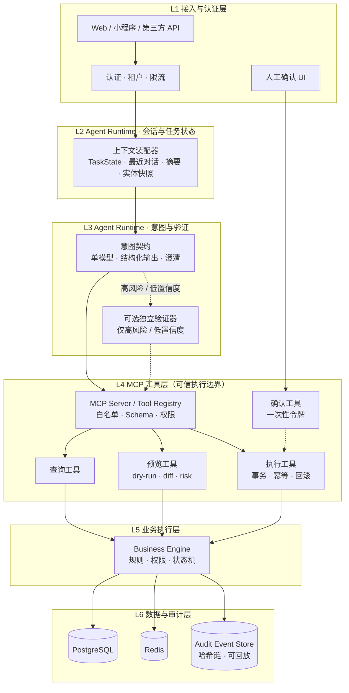

# LyMatrix TEF

> **Trusted Execution Framework for AI Agents**
> 为 LLM 的副作用建立确定性执行边界。

LyMatrix TEF 是一个面向 AI Agent 的可信执行框架。它不试图让模型输出变得确定，而是让模型产生的**副作用**变得确定：任何写操作都必须经过契约校验、证据加载、风险定级、预览快照、一次性令牌确认和幂等执行，否则被阻断、拒绝或转人工。

**当前状态（2026-11-09）**：Phase 0 闭环与 Phase 1 补偿运行时已落地并通过自动化验证——多租户、契约引擎、MCP 工具层、预览快照、一次性令牌、双层哈希、幂等执行、审计哈希链、最小 Agent Runtime、确认 UI 与补偿闭环全部可运行，295 个测试通过（含 27 个对真实 PostgreSQL 的闭环、攻击场景与补偿集成测试）。尚未达到生产可用：评测体系（Phase 2）、遗留代码清理、崩溃恢复与并发压测仍未完成。成熟度口径见 [docs/00-positioning.md](docs/00-positioning.md)，逐项差距见 [挑战杯项目设计说明书 §7.4](docs/competition/挑战杯项目设计说明书.md)。

---

## 这是什么 / 不是什么

| 是 | 不是 |
|----|------|
| 面向 LLM 工具调用与写入的可信执行边界 | 另一个通用 Agent 编排框架 |
| 契约驱动的确定性校验与执行引擎 | 靠提示词让模型"不要出错"的护栏 |
| 可审计、可回放、可评测的参考架构 | 已通过生产验证的工业级成品 |
| 以 CRM-ERP 赊账订单为参考实现 | 一个以 CRM-ERP 为最终形态的产品 |

---

## 核心命题

> 模型是可替换的大脑，MCP 工具层是不可绕过的脊柱。

- 模型只负责理解与提议；
- 确定性系统负责校验、预览、确认、执行；
- 风险分级决定是否需要人授权；
- 事件溯源负责追责与回放。

### 三条不可妥协的边界

1. **唯一写入通道**：所有业务写入必须经过 MCP Server，Agent 不持有数据库凭据。
2. **令牌即授权**：执行工具只接受 `confirmation_token + idempotency_key`，不接受模型重新生成的业务参数。
3. **确认不可绕过**：L2 必须人工 approve；白名单只能调整阈值，不能跳过 preview、确认、幂等或审计。

---

## 仓库现状与目标结构

| 目录 | 现状 | 目标 |
|------|------|------|
| `docs/` | 框架设计、参考实现与合规文档 | 拆分为 `docs/core/` 与 `docs/reference/crm-erp/` |
| `packages/tef-core/` | 框架治理核心（契约、风险、哈希、effects），不依赖 IO 与业务字段 | 保持零 IO、零垂直依赖，作为 MCP Kit、Runtime 与垂直包的公共底座 |
| `src/` | Next.js 参考实现与尚未迁出的模块 | 后续阶段继续下沉到 `packages/` 与 `apps/` |
| `prisma/` | 参考实现数据模型 | 后续阶段拆分为 business / tef / runtime schema |

代码目录拆分已启动：纯治理模块已迁入 `packages/tef-core/`，Next.js 参考实现仍留在 `src/`；仓库改名与其余拆分随后续阶段推进。框架核心不得依赖 CRM 字段、订单模型或义乌规则。

---

## 架构总览

### 架构图



### 请求路径

```
用户/前端
  → 认证与租户
  → Agent Runtime（上下文装配 + 意图契约 + 可选验证器）
  → MCP Server（查询 / 预览 / 确认 / 执行）
  → Business Engine（规则 / 权限 / 状态机）
  → PostgreSQL / Redis / Audit Store
```

### 分层职责

| 层级 | 名称 | 核心职责 |
|------|------|----------|
| L1 | 接入与认证层 | 认证、租户识别、限流、请求规范化 |
| L2 | Agent Runtime 会话与任务状态层 | 装配 TaskState、对话摘要、实体快照；恢复未完成任务 |
| L3 | Agent Runtime 意图与验证层 | 意图识别、槽位抽取、澄清；高风险时调用独立验证器 |
| L4 | MCP 工具层 | 工具白名单、Schema 校验、权限、预览、确认令牌、幂等、审计 |
| L5 | 业务执行层 | 契约引擎、规则、状态机、事务、补偿 |
| L6 | 数据与审计层 | 业务数据、缓存、事件日志、哈希链 |

---

## 核心模块

| 模块 | 说明 |
|------|------|
| **MCP 工具链** | 查询、预览、执行、治理、知识五类工具，是唯一写入通道 |
| **业务操作契约引擎** | 每类操作的前置条件、不变量、权限、风险、补偿 |
| **风险路由** | L0/L1/L2/Block 四档，决定自动执行、人工确认或阻断 |
| **人工确认工作流** | 一次性令牌、绑定操作哈希、过期与拒绝 |
| **审计与回放** | 事件溯源、哈希链、按实体/trace 回放 |
| **评测基准** | 中文业务写入评测集、基线、消融实验 |
| **垂直扩展机制** | 契约与插件注入；参考实现为义乌赊账、定金、色码规格等规则 |

### Agent Runtime 的定位

| 能力 | 说明 |
|------|------|
| 模型调用 | 默认接入 DeepSeek，也可替换为任意 OpenAI 兼容模型 |
| MCP Client | 工具发现、调用、结果解析 |
| 上下文装配 | TaskState、最近对话、摘要、实体快照 |
| 任务状态 | 多轮对话、待确认操作、断点恢复 |
| 流式输出 | 响应展示 |

Agent Runtime 不持有数据库凭据，不直接执行写操作；模型可以替换，工具链和护栏不变。

---

## 风险分级与执行路径

| 等级 | 操作类型 | 执行路径 | 人工确认 |
|------|----------|----------|----------|
| **L0** | 查询类 | 查询工具直读 | 不需要 |
| **L1** | 低风险写入 | preview → execute | 不需要，但需幂等与审计 |
| **L2** | 高风险写入 | preview → 可选验证器 → 人工确认 → execute | 必须 |
| **Block** | 非法/越权/违反不变量 | 直接阻断 | 不进入确认 |

### 多 Agent 的定位

多 Agent 不再是默认风控层。只在以下场景使用：

- 高风险时的独立验证器
- 不同工具/数据源的专业代理
- 对抗式红队检查
- 不同厂商模型的第二意见

同模型、同上下文、不同提示词的"投票"不作为核心机制。

---

## 参考实现：义乌赊账订单

当前 `src/` 是基于 Next.js 的 CRM-ERP 参考实现，用于验证框架的关键路径：

- 多租户与行级隔离
- 客户信用额度与逾期风险
- 订单预览、库存预占与补偿
- L2 人工确认与一次性令牌
- 审计事件与 trace 回放

它属于 reference implementation，不是框架本体。后续目标路径为 `examples/crm-erp`。

---

## 文档导航

### 定位与核心架构

| 文档 | 说明 |
|------|------|
| [docs/00-positioning.md](docs/00-positioning.md) | **定位与命名**：核心命题、边界、成熟度、与 CRM-ERP 的关系 |
| [docs/00-framework.md](docs/00-framework.md) | **项目框架总览**：分层架构、信任域、核心机制、MCP 工具、数据模型、核心流程、代码映射与实施进度 |
| [docs/technical/14-unified-architecture.md](docs/technical/14-unified-architecture.md) | **统一架构框架（裁决版，单一权威）**：六条公理、信任域、L0/L1/L2/Block、契约引擎、审计合规 |
| [docs/technical/13-trusted-execution-architecture.md](docs/technical/13-trusted-execution-architecture.md) | 可信执行架构详细设计：业务操作契约、MCP 工具链、评测基准 |
| [docs/technical/06-system-architecture.md](docs/technical/06-system-architecture.md) | 整体技术架构设计：技术选型、分层职责、核心流程、部署 |
| [docs/superpowers/specs/2026-11-09-tef-extraction-design.md](docs/superpowers/specs/2026-11-09-tef-extraction-design.md) | 框架剥离与 P1/P2 收尾设计：包边界、API 契约、跨服务执行状态机 |

### 比赛材料

| 文档 | 说明 |
|------|------|
| [docs/competition/挑战杯项目设计说明书.md](docs/competition/挑战杯项目设计说明书.md) | 挑战杯版项目设计说明书：设计思路、创新点、现状差距、评测方案与答辩手册 |

### 技术文档全集

| 文档 | 说明 |
|------|------|
| [01-multi-agent-design.md](docs/technical/01-multi-agent-design.md) | Multi-Agent 协同决策（历史方案，投票已降级为可选验证器） |
| [02-openclaw-development.md](docs/technical/02-openclaw-development.md) | OpenClaw 内核定制（历史方案，当前不再使用） |
| [03-mcp-tool-whitelist.md](docs/technical/03-mcp-tool-whitelist.md) | MCP 工具白名单体系（命名与分类以 14 号为准） |
| [04-business-engine.md](docs/technical/04-business-engine.md) | 统一业务引擎设计（规则已并入契约 Check） |
| [05-four-layer-safety.md](docs/technical/05-four-layer-safety.md) | 六重防护机制（历史方案，以可信执行边界为准） |
| [07-data-flow-design.md](docs/technical/07-data-flow-design.md) | 核心请求全流程（历史方案，保留作对比） |
| [08-risk-classification.md](docs/technical/08-risk-classification.md) | 风险分级素材（等级模型已由 14 号裁决） |
| [09-fast-path.md](docs/technical/09-fast-path.md) | 白名单等级与阈值调整（边界已由 14 号收窄） |
| [10-dynamic-risk.md](docs/technical/10-dynamic-risk.md) | 动态风险因子素材（已降级为 riskRules 输入） |
| [11-fallback.md](docs/technical/11-fallback.md) | 多级兜底策略（待按 14 号重写） |
| [12-hook-system-design.md](docs/technical/12-hook-system-design.md) | Hook 系统（已收编为契约 Check 实现） |

### 参考垂直材料

以下文档属于义乌 CRM-ERP 参考实现的商业验证材料，不代表框架核心范围：

| 文档 | 说明 |
|------|------|
| [docs/business/01-market-positioning.md](docs/business/01-market-positioning.md) | 参考垂直的市场定位与竞争分析 |
| [docs/business/02-pricing-strategy.md](docs/business/02-pricing-strategy.md) | 参考垂直的定价策略与商业模式 |
| [docs/business/03-customer-validation.md](docs/business/03-customer-validation.md) | 参考垂直的客户验证方案 |
| [docs/business/04-industry-barriers.md](docs/business/04-industry-barriers.md) | 参考垂直的行业 Know-how 分析 |

### 合规文档

| 文档 | 说明 |
|------|------|
| [docs/compliance/01-open-source-compliance.md](docs/compliance/01-open-source-compliance.md) | 开源协议合规方案 |
| [docs/compliance/02-data-security.md](docs/compliance/02-data-security.md) | 数据安全与合规体系 |

---

## 成熟度与落地计划

| 阶段 | 核心交付物 | 状态（2026-11-08） |
|------|------------|--------------------|
| Phase 0 | 多租户底座 + 契约引擎 + 跑通"赊账订单"闭环：查询客户、查额度、查库存、预览订单、执行订单 | **已完成**，CI 每次推送对真实 PostgreSQL 复跑闭环与攻击场景 |
| Phase 1 | L1 自动执行路径、dry-run/diff、确认令牌、幂等、冲突恢复、补偿、审计事件 | **已完成主要项**：L1 路径、diff、令牌、幂等、审计事件、`CONFLICT` 检测与旧令牌作废、`compensate_order` 契约与完整补偿运行时（preview → L2 → 人工确认 → execute）均已实现并有测试；崩溃恢复与并发压测仍待补 |
| Phase 2 | 300-500 条评测集、危险写入拦截率、误拒率、P95、成本；核心与垂直解耦 | 未开始 |
| Phase 3 | 参考垂直插件、计量计费与配额、角色细化、生产部署、软著/专利/论文材料 | 未开始 |

当前对外表述应使用"参考架构 / framework，目标工业级"，不得宣称已达到工业级生产可用。Phase 0 闭环与补偿回滚均已验证，但崩溃恢复、并发压测与生产级认证尚未完成，因此仍不宣称 L1 完整达成。

---

## 本地运行

前置：Node 22+、PostgreSQL、（可选）Redis 与 DeepSeek API key。

所有配置统一放在仓库根目录的 `.env`（已被 `.gitignore` 忽略），模板见 `.env.example`。项目不再读取 `.env.local`。

```bash
cp .env.example .env            # 唯一配置入口，禁止提交
npm install

# 1. 填写 .env：DATABASE_URL 必填
#    生成令牌签名密钥（至少 32 字符，缺失时服务拒绝签发令牌）
node -e "console.log(require('crypto').randomBytes(48).toString('base64url'))"
#    把输出填进 .env 的 TEF_TOKEN_SECRET

# 2. 建库并灌入参考场景数据
npm run db:bootstrap            # 先建 tenants 表并写入默认租户（外键顺序要求）
npx prisma db push              # 同步其余 schema
npx prisma generate
npm run db:seed                 # 义乌赊账订单演示数据：两个"伟业"候选、圣诞球库存、角色成员

# 3. 启用行级安全
npm run rls:apply
npm run rls:verify              # 7 项隔离检查，用真实查询证明策略生效

# 4. 验证与运行
npm test                        # 单元测试
TEF_DB_TESTS=1 npm test         # 加上对真实数据库的闭环与攻击场景集成测试
npm run dev                     # http://localhost:3000/login，账号 admin@example.com / demo123
```

登录后进入 `/chat`，输入：

> 给伟业公司下一单，5000 个圣诞球，单价 2 块，先付 30% 定金，余款 30 天账期

会依次看到：重名澄清（两个"伟业"候选）→ 选定客户 → L2 风险判定与服务端 diff → 人工批准 → 出单与审计事件 ID。整个过程共用一条 `traceId`，可用 `audit.trace` 工具回放。

完整变量清单与默认值见 [docs/00-framework.md §9.5](docs/00-framework.md#95-关键环境变量)。

---

## 与 OpenClaw 的关系

项目早期文档曾以 OpenClaw 为内核进行设计，但当前代码没有 OpenClaw 依赖，且 OpenClaw 的 MIT 协议本身不构成技术壁垒。当前架构改为：

- 使用 MCP 作为标准工具协议
- 使用轻量 Agent Runtime 作为模型适配与上下文装配层
- 使用特制 MCP 工具链作为可信执行边界
- 模型可替换，工具链和审计不变

历史文档 [02-openclaw-development.md](docs/technical/02-openclaw-development.md) 保留用于回顾，不再作为当前实现依据。
