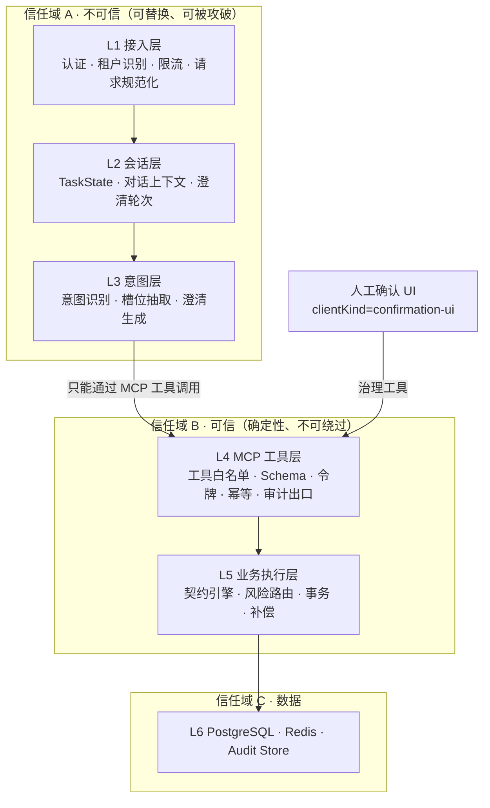
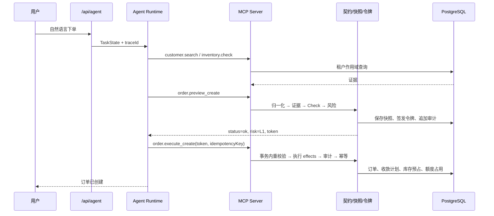
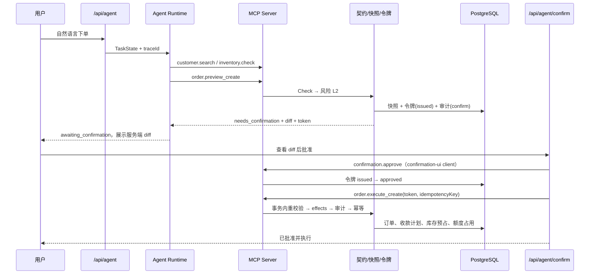
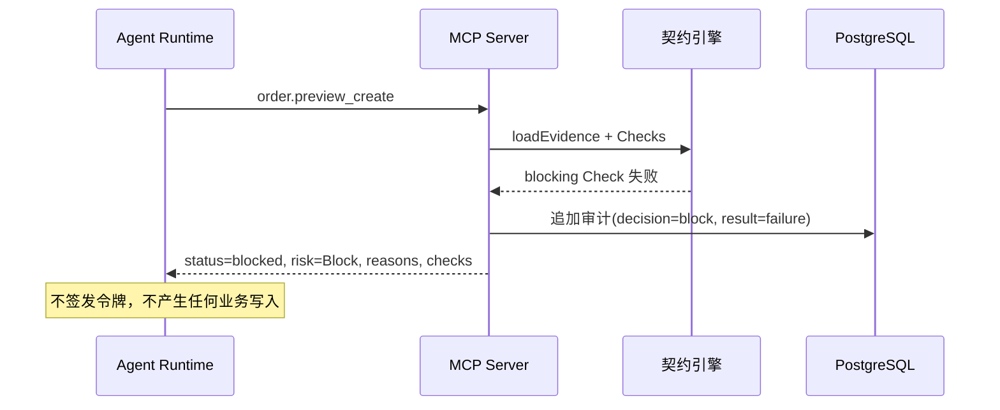
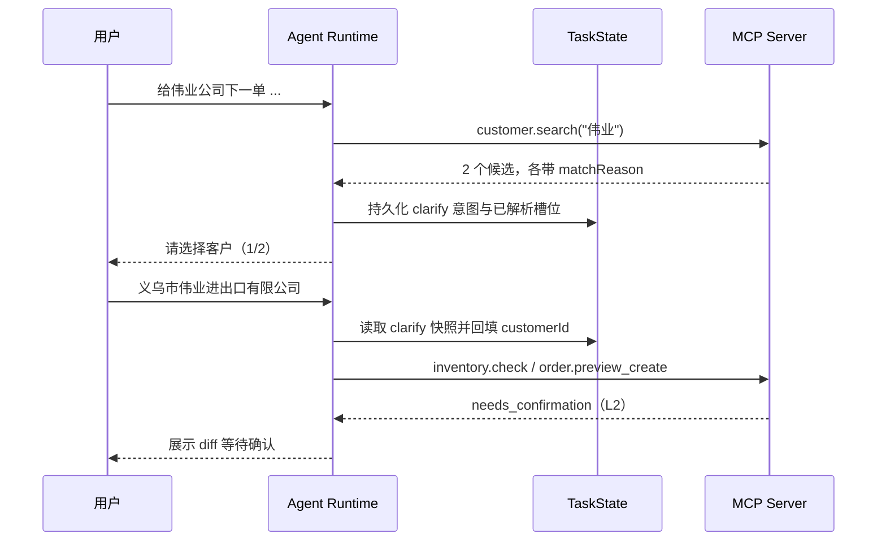
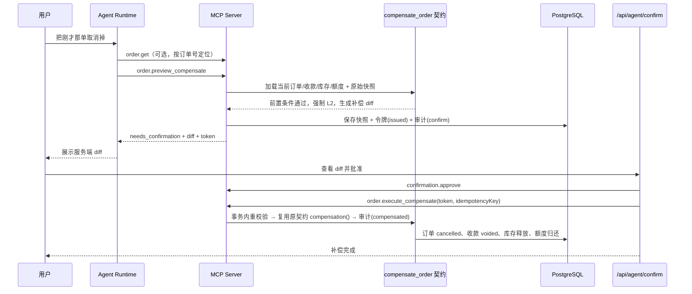

# LyMtrix-TEF 项目框架总览

> **文档版本**：v1.1（2026-11-09）
> **代码基线**：`feature/tef-extraction` 工作区（2026-11-09）
> **当前成熟度**：设计 L0 已完成；Phase 0 闭环与 Phase 1 补偿运行时已落地；崩溃恢复与并发压测未完成
> **权威关系**：架构裁决以 [technical/14-unified-architecture.md](technical/14-unified-architecture.md) 为准。本篇是全景入口与代码映射，当本篇与 14 号文档冲突时，以 14 号文档为准。

---

## 1. 文档定位与阅读方式

本篇回答四个问题：

1. 这个项目是什么、边界在哪里；
2. 系统由哪些层、哪些模块构成，它们之间的信任关系是什么；
3. 写入从一句自然语言到落库，经过哪些确定性关卡；
4. 哪些能力已经实现、哪些只是设计、哪些明确未做。

全文使用三种事实标记：

| 标记 | 含义 |
|------|------|
| **已实现** | 仓库中存在可运行代码，且有对应自动化测试 |
| **已设计未实现** | 设计已采纳并写入权威文档，但没有运行时路径 |
| **遗留** | 早期原型代码仍在仓库，但不在 TEF 执行路径上 |

---

## 2. 项目定位与边界

### 2.1 一句话定位

> **LyMtrix-TEF（Trusted Execution Framework）为 AI Agent 的副作用建立确定性执行边界。**
> 它不追求模型输出确定，而是保证写操作只有在契约校验、证据加载、风险定级、预览快照、一次性令牌确认和幂等执行之后才产生副作用。

### 2.2 是什么与不是什么

| 是 | 不是 |
|----|------|
| 面向 AI Agent 写入副作用的执行治理框架 | 通用 Agent 编排平台 |
| 以 MCP 工具层作为唯一写入通道 | 传统 CRM/ERP 产品 |
| 用契约、令牌、快照、审计构成的可信执行边界 | 提示词护栏或输出格式校验的封装 |
| 以义乌赊账订单为第一个参考实现与评测载体 | 只适用于义乌或外贸场景的垂直系统 |
| 目标工业级（L3）的参考架构 | 已通过安全评审、压测与 SLA 验证的生产系统 |

### 2.3 参考实现与框架本体的关系

CRM-ERP 是框架的第一个验证垂直，不是项目最终形态。框架核心不得依赖 CRM 字段、订单模型或义乌规则；垂直能力通过契约与实体适配器注入。

- 框架核心：`packages/tef-core/`（纯治理）、`packages/tef-mcp-kit/`（通用 MCP 工具层与状态存储）、`packages/tef-runtime/`（意图、LLM、TaskState 与编排）
- 垂直实现：`verticals/crm-erp-mcp/`（`src/contracts/credit-order/` 与 `src/mcp-server/` 保留迁移 shim）
- 接入与运行时：`src/app/`；`src/agent-runtime/`、`src/tef/` 保留迁移 shim

### 2.4 成熟度口径

| 级别 | 定义 | 当前状态 |
|------|------|----------|
| L0 设计 | 架构、契约、威胁模型成文 | 已完成 |
| L1 参考实现 | 一个垂直端到端跑通 | 进行中：Phase 0 闭环与 Phase 1 补偿运行时已跑通并持续验证；崩溃恢复与并发压测未完成，因此尚未达到完整 L1 |
| L2 框架 Beta | 核心与垂直解耦，具备 SDK、文档与测试 | 进行中：@lymtrix/tef-core、@lymtrix/tef-mcp-kit 与 @lymtrix/tef-runtime 已独立成包且由 ESLint/边界检查约束；SDK 与服务化仍待完成 |
| L3 工业级 | 安全评审、压测、兼容性、SLA | 未开始 |

对外表述必须注明当前级别。不得把 L0/L1 表述为 L3，也不得把“Phase 0 闭环跑通”等同于“L1 已完成”。

---

## 3. 总体架构

### 3.1 分层架构



### 3.2 分层职责

| 层 | 核心职责 | 绝对不能做 | 当前代码 |
|----|----------|-----------|----------|
| L1 接入层 | 认证、租户识别、限流、请求规范化 | 处理业务规则 | `src/proxy.ts`、`src/app/api/auth/`、`src/lib/rate-limit.ts` |
| L2 会话层 | 装配 TaskState、对话上下文、恢复未完成任务 | 把聊天记录当作业务事实 | `packages/tef-runtime/src/task-state.ts`（`src/tef/task-state.ts` 为 shim）、`src/app/api/agent/route.ts` |
| L3 意图层 | 意图识别、槽位抽取、澄清生成 | 直接写库，或直接决定金额/库存/权限 | `packages/tef-runtime/src/`（`src/agent-runtime/` 为 shim） |
| L4 MCP 工具层 | 工具白名单、Schema 校验、令牌签发与校验、幂等、审计出口 | 暴露裸 SQL/裸 CRUD；接受未经预览的参数 | `packages/tef-mcp-kit/src/`、`verticals/crm-erp-mcp/src/`（`src/mcp-server/` 为 shim） |
| L5 业务执行层 | 契约引擎、规则校验、风险路由、事务、补偿 | 接受未经契约校验的参数 | `packages/tef-core/`、`packages/tef-mcp-kit/src/`、`verticals/crm-erp-mcp/src/contracts/`（`src/tef/`、`src/contracts/` 为 shim） |
| L6 数据层 | 业务数据、缓存、事件日志、哈希链 | 被 Agent 直接访问 | `prisma/` |

### 3.3 信任域

| 信任域 | 包含层 | 是否承载安全责任 | 设计含义 |
|--------|--------|------------------|----------|
| A 不可信 | L1、L2、L3 | 否 | 模型可替换、Agent 可被攻破、上下文可被污染，均不应改变可信域判定 |
| B 可信 | L4、L5 | 是 | 确定性、不可绕过；所有写入必须经过这里 |
| C 数据 | L6 | 否 | 仅被 L4/L5 访问；租户隔离由应用作用域与 RLS 共同保证 |

### 3.4 六条设计公理与实现映射

| # | 公理 | 含义 | 当前实现 |
|---|------|------|----------|
| **I1** | 单一写入通道 | 所有业务写入必须经 MCP Server，UI/REST、Agent、定时任务概不例外 | `packages/tef-mcp-kit/src/server.ts` 与 `verticals/crm-erp-mcp/src/server.ts` 是 TEF 路径唯一写入入口（`src/mcp-server/server.ts` 为 shim）；遗留 REST 路由不在该路径 |
| **I2** | 模型无凭据 | Agent Runtime 不持有数据库凭据，不 import BusinessEngine | `packages/tef-runtime/src/runtime.ts` 只持有 MCP client（`src/agent-runtime/runtime.ts` 为 shim）；ESLint `no-restricted-imports` 禁止 import Prisma/BusinessEngine |
| **I3** | 令牌即授权 | 执行工具只接受 `confirmation_token + idempotency_key` | `order.execute_create` 的 schema 只有这两个字段，业务参数取自服务端快照 |
| **I4** | 确认不可绕过 | L2 必须人工 approve；白名单只能调整阈值 | 工具按 client 身份注册，Agent 物理上看不到 `confirmation.approve`；白名单只影响 `resolveAmountThreshold` |
| **I5** | 契约是唯一规则源 | 前置条件、不变量、权限、风险、补偿全部在契约声明 | `verticals/crm-erp-mcp/src/contracts/credit-order/create-order.ts`（`src/contracts/credit-order/create-order.ts` 为 shim）；旧 BusinessRule/Hook/投票器不参与 TEF 判定 |
| **I6** | 一切可回放 | 输入、提议、校验、预览、确认、执行都产生带 `trace_id` 的事件 | `packages/tef-mcp-kit/src/audit-chain.ts`（`src/tef/audit-chain.ts` 为 shim）；`audit.trace` 按 traceId 还原完整决策链 |

### 3.5 六重防护

| 层 | 机制 | 作用 | 代码位置 |
|----|------|------|----------|
| 事实层 | 工具 grounding | 客户、订单、库存、额度必须查库 | `verticals/crm-erp-mcp/src/tools/query.ts`（`src/mcp-server/tools/query.ts` 为 shim） |
| 输出层 | 结构化输出 | Zod Schema 约束意图与参数 | `packages/tef-runtime/src/intent.ts`（`src/agent-runtime/intent.ts` 为 shim）、契约 `inputSchema` |
| 规则层 | 确定性校验 | 前置条件、不变量、权限、金额边界、状态机 | `packages/tef-core/src/contract-engine.ts`、契约 Check |
| 预览层 | dry-run + diff | 展示“将要发生什么”，不写库 | `packages/tef-mcp-kit/src/preview-store.ts`（`src/tef/preview-store.ts` 为 shim）、契约 `diff` |
| 确认层 | 人工确认 | L2 由人查看服务端 diff 与证据后授权 | `src/app/api/agent/confirm/route.ts`、确认 UI |
| 执行层 | 事务 + 幂等 + 回滚 | 重复请求不重复执行；事务内失败整体回滚 | `verticals/crm-erp-mcp/src/tools/order.ts`（`src/mcp-server/tools/order.ts` 为 shim）、`packages/tef-core/src/effect-executor.ts` |
| 审计层 | 事件日志 + 哈希链 | 可追溯、可回放、可验证篡改 | `packages/tef-mcp-kit/src/audit-chain.ts`（`src/tef/audit-chain.ts` 为 shim）、`packages/tef-core/src/redaction.ts` |

---

## 4. 可信执行核心机制

### 4.1 契约引擎

契约是唯一规则源。一个业务操作的全部规则都在契约中声明，引擎按固定顺序执行。

**预览阶段执行顺序**：

```text
normalize → inputSchema 双向校验 → loadEvidence → permissions → preconditions
→ invariants → riskRules → effects → diff → audit
```

任何一步产生 `severity: 'block'` 的失败 Check，立即返回 Block，不再往下执行。

**契约接口字段**：

| 字段 | 职责 | 约束 |
|------|------|------|
| `operation` / `version` | 操作名与版本，令牌绑定版本 | 旧版本令牌不可用于新契约 |
| `inputSchema` | Zod Schema | `normalize` 的输出必须仍满足该 Schema |
| `normalize` | 单位、币种、默认值归一化 | `intentHash` 绑定的是归一化后的参数 |
| `loadEvidence` | 唯一允许 IO 的钩子 | 只读；每个查询必须带 `tenantId` |
| `preconditions` | 失败即阻断 | 纯函数 |
| `invariants` | 执行过程中必须保持 | 纯函数 |
| `permissions` | 角色权限校验 | 纯函数；角色由服务端解析 |
| `riskRules` | 风险定级 | 纯函数；不读墙上时钟、不访问数据库、不依赖全局状态 |
| `effects` | 声明式副作用列表 | 契约自己不写库，由引擎在事务内统一执行 |
| `compensation` | 声明式补偿列表 | 由 `compensate_order` 契约复用；补偿走 preview → L2 → 人工确认 → execute |
| `audit` | 审计前后快照与保留期 | 只放假名引用，不放直接标识 |
| `diff` | 确认页展示的服务端 diff | 不使用模型摘要替代 |

**为什么 Check 与 riskRules 拿不到数据库句柄**：类型上就无法偷偷做 IO。这是风险定级可复现、可离线单测的前提。

**核心文件**：

- `packages/tef-core/src/contract-engine.ts` — 预览与执行前重校验
- `packages/tef-core/src/types.ts` — `Contract`、`Check`、`Effect`、`DiffEntry` 等类型
- `verticals/crm-erp-mcp/src/contracts/credit-order/create-order.ts` — 赊账订单契约（`src/contracts/credit-order/create-order.ts` 为 shim）
- `verticals/crm-erp-mcp/src/contracts/credit-order/adapters.ts` — 垂直实体适配器（`src/contracts/credit-order/adapters.ts` 为 shim）

### 4.2 风险路由

唯一风险模型是 `L0 / L1 / L2 / Block`。`Block` 是结果而不是等级，拥有最高优先级，且不可被任何因子降级。

**判定顺序**：

1. **Block 条件**：未知操作类型、非法金额（非有限数或为负）。
2. **只读查询**：恒为 L0，白名单与阈值都不能影响这一步。
3. **金额阈值**：金额大于租户阈值时升 L2。
4. **敏感字段**：命中 `creditLimit`、`creditLine`、`price`、`cost`、`discount` 等字段时升 L2。
5. **客户风险**：`high_risk` 或 `restricted` 客户升 L2。
6. **其余写入**：默认 L1。

**执行路径与人工确认**：

| 等级 | 操作类型 | 执行路径 | 人工确认 |
|------|----------|----------|----------|
| L0 | 查询类 | 查询工具直读 | 不需要 |
| L1 | 低风险写入 | preview → execute | 不需要，但需幂等与审计 |
| L2 | 高风险写入 | preview → 人工确认 → execute | 必须 |
| Block | 非法、越权、违反不变量 | 直接阻断 | 不进入确认，不签发令牌 |

**白名单只调整阈值，永不跳过确认**：

| 白名单等级 | 阈值倍率 |
|------------|----------|
| none | 1.0 |
| WL1 | 1.0 |
| WL2 | 1.5 |
| WL3 | 2.0 |

框架默认金额阈值为 10,000；参考实现 demo 租户配置为 5,000，用于复现“总额 10,000 判定 L2”的场景。阈值倍率属于 Phase 0 默认值，待 Phase 2 评测后校准。

**核心文件**：`packages/tef-core/src/risk.ts`。

### 4.3 预览快照与双层哈希

**预览快照是执行参数的唯一来源**。执行时按 `previewId` 取回归一化参数，模型无法在批准之后修改它。

| 属性 | 实现 |
|------|------|
| 快照 TTL | 30 分钟 |
| 消费方式 | 一次性消费；条件更新 `status='active'` 原子迁移到 `consumed` |
| 存储内容 | 归一化参数、证据、证据摘要、diff、风险、原因、失败 Check |
| 执行参数来源 | 只来自快照，不接受模型重新生成的业务参数 |

**双层哈希**把“人批准的内容”和“当时看到的证据”分开：

| 哈希 | 计算内容 | 用途 |
|------|----------|------|
| `intentHash` | 契约名 + 契约版本 + 归一化参数 | 绑定令牌与人批准的内容；参数被改则执行失败 |
| `evidenceDigest` | 加载到的证据 | 只进审计，不参与令牌绑定；证据变化不会让确认必然失效 |

**核心文件**：`packages/tef-mcp-kit/src/preview-store.ts`（`src/tef/preview-store.ts` 为 shim）、`packages/tef-core/src/hashing.ts`、`packages/tef-core/src/canonical.ts`。

### 4.4 一次性确认令牌与人工确认

令牌采用两层保证，缺一不可：

- **HMAC-SHA256 签名**：令牌不可伪造、内容不可篡改；
- **数据库原子状态迁移**：一次性消费，重放返回 `CONFLICT`。

**令牌绑定**：`tenantId`、`userId`、`sessionId`、`previewId`、`intentHash`、契约名与版本、风险等级、过期时间。

**生命周期**：

```text
issued ──approve──> approved ──consume──> used
   │                    │
   ├──reject──────────> rejected
   ├──expire──────────> expired
   └──revoke──────────> revoked
```

| 规则 | 实现 |
|------|------|
| L1 令牌 | 签发即生效，无需 approve |
| L2 令牌 | 必须先由独立 client 人工 approve |
| 令牌 TTL | 15 分钟 |
| 落库形式 | 只存 `sha256(token)`，不存令牌原文 |
| 重放 | 条件更新失败，返回 `CONFLICT` |
| 跨租户/跨用户/跨会话 | 绑定校验失败，返回 `PERMISSION_DENIED` |
| 密钥缺失或过短 | 拒绝签发，不降级成弱密钥；密钥至少 32 字符 |

**人工确认的物理隔离**：治理工具按 MCP client 身份注册。Agent client 的工具表里根本没有 `confirmation.approve`，模型不是“被叮嘱不要自己确认”，而是调用不到。

**核心文件**：`packages/tef-mcp-kit/src/token.ts`（`src/tef/token.ts` 为 shim）、`packages/tef-mcp-kit/src/tools/confirmation.ts`（`src/mcp-server/tools/confirmation.ts` 为 shim）、`packages/tef-mcp-kit/src/tenant.ts`（`src/tef/tenant.ts` 为 shim）。

### 4.5 幂等、冲突、事务与补偿

**幂等**：

- 唯一约束 `(tenantId, toolName, idempotencyKey)`；
- 重复请求返回第一次的结果，并标记 `replayed: true`；
- 幂等记录与执行结果、审计事件 ID 一起写入。

**执行前重校验**：

执行不是“相信预览”。在同一个事务内重新加载证据并重跑全部 Check：

| 变化 | 结果 |
|------|------|
| 前置条件失效（额度、库存、客户状态变化） | `CONFLICT`，作废旧令牌，要求重新预览 |
| 风险等级上升 | `CONFLICT`，因为人批准的是原等级 |
| 令牌与快照 `intentHash` 不一致 | `CONFLICT` |
| 快照来自不同契约版本 | `CONFLICT` |

**事务边界**：

令牌消费、快照消费、重校验、副作用写入、审计追加、幂等记录在同一个事务内，要么全部生效，要么全部回滚。

事务内失败不需要补偿契约；已提交后撤销才需要补偿。

**补偿运行时（已实现）**：

- `create_order` 契约声明 `compensation`：订单置为 `cancelled`、收款计划置为 `voided`、释放库存预占、归还信用额度；
- 新增 `compensate_order` 契约：从订单的 `previewId` 找回原始快照，复用原契约的 `compensation()`，不重写补偿规则；
- 补偿同样走 preview → 风险 L2 → 一次性令牌 → 人工确认 → execute，成功后写 `compensated`，失败写 `compensation_failed`；
- 只有经 TEF 创建、带预览快照的订单可补偿；已收款订单要求走退款流程，直接阻断；
- 补偿执行是单事务，失败整体回滚；幂等键防止重复释放库存或重复归还额度；
- 补偿的补偿返回空列表，避免递归。

**核心文件**：`packages/tef-mcp-kit/src/tools/contract.ts`（`src/mcp-server/tools/contract.ts` 为 shim）、`verticals/crm-erp-mcp/src/tools/order.ts`（`src/mcp-server/tools/order.ts` 为 shim）、`packages/tef-core/src/effect-executor.ts`、`verticals/crm-erp-mcp/src/contracts/credit-order/create-order.ts`（`src/contracts/credit-order/create-order.ts` 为 shim）、`verticals/crm-erp-mcp/src/contracts/credit-order/compensate-order.ts`（`src/contracts/credit-order/compensate-order.ts` 为 shim）。

### 4.6 审计哈希链与脱敏

**哈希链**：

- 每租户一条链；
- 追加公式：`hash = H(prevHash ‖ canonical(event))`；
- 链头行作为乐观锁锚点，并发追加时只有一个能推进 `seq`；
- `verify()` 逐条重算 `seq`、`prevHash`、`payloadDigest`、`hash`，定位第一个断点；
- 审计写入与业务写入同生共死；失败记录在另一个事务中补写，避免“失败过”也查不到。

**审计事件字段**：`traceId`、`actorId`、`actorType`、`tool`、`contract`、`contractVersion`、`intentHash`、`argsRedacted`、`evidenceDigest`、`risk`、`reasons`、`decision`、`result`、`subjectRef`、`modelVersion`、`promptVersion`、`ts`、`prevHash`、`hash`、`payloadDigest`。

**脱敏策略**：

- 默认拒绝：命中敏感键名整体替换为 `[redacted]`，不做局部打码；
- 键名归一化后按后缀与子串匹配，覆盖 `contactPhone`、`buyerEmail`、`shipAddress` 等复合命名；
- 审计只存假名引用，如 `cust:<id>`、`order:<id>`；
- 哈希链不可变与个人信息删除权的兼容方式是 crypto-shredding，但密钥管理（KMS）尚未实现。

**核心文件**：`packages/tef-mcp-kit/src/audit-chain.ts`（`src/tef/audit-chain.ts` 为 shim）、`packages/tef-core/src/redaction.ts`、`packages/tef-core/src/hashing.ts`。

### 4.7 TaskState 与澄清协议

**TaskState 是任务的唯一事实源**。对话上下文只保存“说了什么”，任务进行到哪一步只存在 TaskState。

| 能力 | 实现 |
|------|------|
| 12 状态机 | `idle`、`intent_parsed`、`awaiting_clarification`、`context_loaded`、`preview_ready`、`awaiting_confirmation`、`executing`、`completed`、`failed`、`compensated`、`compensation_failed`、`conflict` |
| 乐观锁 | `version` 不匹配返回 `CONFLICT` |
| 任务级 trace | 澄清往返、预览、确认、执行共用同一条审计链 |
| 持久化幂等键 | 人工确认前生成，批准后执行复用 |
| 澄清轮次 | 默认上限 3 轮，超过则终止任务 |
| 澄清候选 | 每个候选带 `matchReason`，说明为什么是候选 |
| 意图快照 | 追问时连同已解析槽位一起持久化，用户回答后不必从头再说 |

**核心文件**：`packages/tef-runtime/src/task-state.ts`（`src/tef/task-state.ts` 为 shim）、`packages/tef-runtime/src/runtime.ts`（`src/agent-runtime/runtime.ts` 为 shim）。

### 4.8 一次写入的完整生命周期

以赊账订单为例：

```text
1. 用户自然语言输入
2. L3 意图解析：抽取客户、SKU、数量、单价、定金比例、账期
3. 实体消歧：候选多于 1 时澄清；用户选择后回填槽位
4. 证据加载：客户状态、信用额度、库存、历史逾期
5. 契约校验：权限 → 前置条件 → 不变量
6. 风险定级：L0 / L1 / L2 / Block
7. 预览：计算金额、生成 diff、保存快照、计算双层哈希
8. 签发令牌：绑定租户、用户、会话、快照、intentHash、契约版本
9. 分支：
   - L1：直接进入执行
   - L2：等待独立 client 人工 approve
   - Block：记录审计，终止，不签发令牌
10. 执行前重校验：事务内重新加载证据，检测并发漂移与风险升级
11. 执行副作用：订单、收款计划、库存预占、信用额度占用
12. 审计与幂等：追加哈希链事件，写入幂等记录，提交事务
13. 已提交后撤销：通过 compensate_order 重新走 preview → L2 → 人工确认 → execute，
    按原契约声明的 compensation 反向执行，并写 compensated 审计事件
```

---

## 5. MCP 工具层

### 5.1 工具清单

当前 `createTefServer` 注册 13 个工具：

| 工具 | 类型 | 作用 | 风险 |
|------|------|------|------|
| `customer.search` | 查询 | 按名称/电话搜索客户，返回候选与 `matchReason` | L0 |
| `customer.get` | 查询 | 按 ID 读取客户快照 | L0 |
| `credit.get` | 查询 | 读取信用额度、已用额度、逾期天数 | L0 |
| `inventory.check` | 查询 | 查询 SKU 可用库存、预占库存与档案价 | L0 |
| `order.get` | 查询 | 按订单 ID 或订单号读取订单与收款计划 | L0 |
| `order.preview_create` | 写入预览 | 校验并预览订单创建，返回 diff、风险、快照 ID、令牌；不写业务数据 | L1/L2/Block |
| `order.execute_create` | 写入执行 | 只接受令牌与幂等键，业务参数取自快照 | L1/L2 |
| `order.preview_compensate` | 写入预览 | 校验并预览已提交订单的补偿，返回 diff、风险、快照 ID、令牌 | L2/Block |
| `order.execute_compensate` | 写入执行 | 凭已批准令牌执行补偿，业务参数取自快照 | L2 |
| `confirmation.approve` | 治理 | 人工批准 L2 令牌，返回服务端 diff 与证据 | 仅人工 |
| `confirmation.reject` | 治理 | 人工拒绝令牌，作废底层快照 | 仅人工 |
| `audit.trace` | 查询 | 按 traceId 回放决策链并返回哈希链校验结果 | L0 |
| `policy.get` | 查询 | 读取租户阈值、调用方角色与当前 client 的工具范围 | L0 |

### 5.2 client 身份可见性矩阵

| 工具 | `agent` | `confirmation-ui` | `ops` |
|------|---------|-------------------|-------|
| `customer.search` / `customer.get` | 可见 | 部分可见（`customer.get`） | 可见 |
| `credit.get` / `inventory.check` / `order.get` | 可见 | 可见 | 可见 |
| `order.preview_create` / `order.execute_create` | 可见 | 不可见 | 不可见 |
| `order.preview_compensate` / `order.execute_compensate` | 可见 | 不可见 | 不可见 |
| `confirmation.approve` / `confirmation.reject` | **不可见** | 可见 | 可见 |
| `audit.trace` / `policy.get` | 可见 | 部分可见（`audit.trace`） | 可见 |
| `whitelist.list` / `whitelist.set` / `tenant.config.get` | 不可见 | 不可见 | 已声明，当前未注册 |

说明：`ops` 身份在 `toolsForClient` 中声明了 3 个白名单/租户配置工具，但 `createTefServer` 当前未注册它们，属于预留能力。

### 5.3 角色 scope 矩阵

| 角色 | 查询 | 订单预览/执行 | 人工确认 | 说明 |
|------|------|---------------|----------|------|
| `owner` | 全部 | 可以 | 可以 | 参考实现中批准权收敛到 owner |
| `sales` | 客户、订单、支付、库存、额度 | 可以 | 不可以 | 发起人与批准人分离 |
| `finance` | 客户只读、支付、额度、订单、库存 | 可以 | 不可以 | 不可修改客户档案 |
| `viewer` | 仅查询类 | 不可以 | 不可以 | 最小权限 |

角色与租户由服务端从成员关系解析，不接受模型声明。工具 scope 是第一道门，契约内的 `permissions` 是第二道门：例如 finance 在工具层能看到订单写入工具，但 `create_order` / `compensate_order` 的权限 Check 会拒绝。

### 5.4 统一返回信封

所有工具返回同一个信封结构：

| 字段 | 含义 |
|------|------|
| `status` | `ok` / `needs_confirmation` / `blocked` / `conflict` / `error` |
| `data` | 业务结果 |
| `diff` | 服务端计算的变更 |
| `evidence` | 判定所依据的证据 |
| `risk` | `L0` / `L1` / `L2` / `Block` |
| `reasons` | 判定原因 |
| `previewId` / `confirmationToken` / `expiresAt` | 预览与令牌信息 |
| `auditId` / `traceId` | 审计定位 |
| `error` | `{ code, message, checks? }` |

稳定错误码：`VALIDATION_ERROR`、`PERMISSION_DENIED`、`NOT_FOUND`、`CONFLICT`、`NEEDS_CONFIRMATION`、`RATE_LIMITED`、`INTERNAL`。

`blocked`、`conflict`、`needs_confirmation` 是确定性判定结果，不是工具故障；只有 `status='error'` 才标记为 MCP 工具错误，这样 Agent 能区分“重试”“退避”“重新预览”。

### 5.5 传输与信任边界

Agent Runtime 与 MCP Server 之间使用真实的 MCP 协议栈和进程内 `InMemoryTransport` 链接对，而不是直接函数调用。这样信任边界物理存在：Runtime 手里只有一个 Client，拿不到 Prisma、拿不到 BusinessEngine、也看不到治理工具。

人工确认 UI 建立的是另一个 `clientKind='confirmation-ui'` 的独立会话，因此看到的是另一套工具集。

**核心文件**：`packages/tef-mcp-kit/src/server.ts`、`packages/tef-mcp-kit/src/transport.ts`、`packages/tef-mcp-kit/src/envelope.ts`、`packages/tef-mcp-kit/src/principal.ts`、`packages/tef-mcp-kit/src/tenant.ts`（对应 `src/mcp-server/`、`src/tef/tenant.ts` 均为 shim）。

---

## 6. 数据模型

### 6.1 模型分组

`prisma/schema.prisma` 当前定义 19 个模型：

| 分组 | 模型 | 状态 |
|------|------|------|
| 租户 | `Tenant`、`TenantMember` | TEF 路径 |
| 身份与会话 | `User`、`Session` | 接入层使用 |
| 业务实体 | `Customer`、`Order`、`Payment`、`Product` | 参考实现 |
| 遗留治理 | `WhitelistEntry`、`ConfirmationRequest`、`AuditLog` | 遗留；TEF 确认走快照 + 令牌，审计走哈希链 |
| TEF 核心 | `PreviewSnapshot`、`ConfirmationToken`、`IdempotencyRecord`、`AuditChainHead`、`AuditEvent`、`TaskState` | TEF 路径 |
| 可观测性 | `SystemLog`、`HookExecutionLog` | 遗留/运维 |

### 6.2 TEF 核心表

| 表 | 职责 | 关键约束 |
|----|------|----------|
| `preview_snapshots` | 执行参数的唯一来源 | `intentHash`、`evidenceDigest`、`status`、`expiresAt` |
| `confirmation_tokens` | 一次性确认令牌 | `tokenHash` 唯一；`status` 状态机；绑定租户/用户/会话/快照/意图 |
| `idempotency_records` | 幂等去重 | 唯一约束 `(tenantId, toolName, idempotencyKey)` |
| `audit_chain_heads` | 每租户链头 | 主键 `tenantId`；`lastSeq`、`lastHash` |
| `audit_events` | 只追加审计事件 | 唯一约束 `(tenantId, seq)`；`hash` 唯一 |
| `task_states` | 任务状态 | 唯一约束 `(tenantId, conversationId)`；乐观锁 `version` |

### 6.3 行级安全（RLS）

15 张租户表启用 RLS：

| 档位 | 表 |
|------|----|
| 启用并 FORCE（7 张） | `audit_events`、`audit_chain_heads`、`preview_snapshots`、`confirmation_tokens`、`idempotency_records`、`task_states`、`products` |
| 仅启用（8 张） | `customers`、`orders`、`payments`、`users`、`sessions`、`whitelist_entries`、`confirmation_requests`、`audit_logs` |

**为什么不是全量 FORCE**：开发库连接角色是表 owner，而 owner 默认不受 RLS 约束，只有 `FORCE` 才生效。一旦对 `customers`/`orders`/`payments` 强制启用，尚未迁移到租户作用域的遗留 REST 路由会静默返回空结果集，这比没有隔离更危险。

**策略本身已被证明正确**：CI 先创建 `NOSUPERUSER NOBYPASSRLS` 且不拥有任何表的应用角色 `lymtrix_app`，再用它执行 `rls:verify`。在这个角色下所有启用 RLS 的表都真正受约束。生产部署使用非 owner 角色连接即可，无需改策略。

**超级用户陷阱**：超级用户与 `BYPASSRLS` 角色永远绕过 RLS，`FORCE` 也拦不住。`rls:verify` 会先检查当前角色，发现是超级用户时直接拒绝执行并给出修复指令。

### 6.4 租户隔离的双重防线

1. **RLS**：策略读取 PostgreSQL 会话变量 `app.tenant_id`；`set_config(..., true)` 只在事务内有效，连接归还连接池后变量失效。
2. **应用层显式条件**：所有查询与更新都带 `where.tenantId`；更新使用 `updateMany + { id, tenantId }` 并检查影响行数，即使拿到别租户主键也改不动。

**核心文件**：`prisma/schema.prisma`、`prisma/rls.sql`、`packages/tef-mcp-kit/src/tenant-scope.ts`（`src/tef/tenant-scope.ts` 为 shim）。

---

## 7. 核心流程

### 7.1 L1 自动执行



L1 没有人工确认环节，但仍然幂等、仍然写完整审计。

### 7.2 L2 人工确认



关键点：

- 批准使用独立的 `confirmation-ui` client；
- 发起人与批准人角色分离，Phase 0 批准权收敛到 owner；
- 批准后执行复用 TaskState 中持久化的幂等键；
- 确认页展示服务端 diff 与判定依据，不用模型摘要替代。

### 7.3 Block 阻断



常见阻断原因：`INSUFFICIENT_INVENTORY`、`INSUFFICIENT_CREDIT`、`PRICE_MISMATCH`、`UNKNOWN_SKU`、`CUSTOMER_INACTIVE`、`PERMISSION_DENIED`、`TOTAL_MISMATCH` 等。

### 7.4 澄清往返



澄清轮次上限为 3。超过上限任务终止，不无限追问。

### 7.5 已提交订单的补偿



关键点：

- 补偿是 L2，永远需要人工确认，不受白名单或金额影响；
- 补偿规则只有一份，来自 `create_order.compensation()`；
- 已收款订单不直接补偿，需要退款流程；
- 补偿幂等键防止重复释放库存或重复归还额度；
- 只有经 TEF 创建、带预览快照的订单可补偿；遗留 REST 订单会被阻断。

---

## 8. 代码框架映射

### 8.1 目录树

```text
.
├── prisma/
│   ├── schema.prisma              # 19 个模型、16 个枚举
│   ├── rls.sql                    # 15 张租户表的 RLS 策略
│   ├── seed.mjs                   # 义乌赊账订单参考场景种子数据
│   └── migrations/                # 数据库迁移
├── scripts/
│   ├── bootstrap-db.mjs           # 建 tenants 表与默认租户
│   └── rls.mjs                    # RLS 应用、验证、撤销、应用角色
├── packages/
│   ├── tef-core/                  # 纯治理核心包（无 IO、无垂直依赖）
│   │   ├── package.json
│   │   └── src/
│   │       ├── business-gateway.ts # 业务数据访问端口（B2 HTTP 网关的替换点）
│   │       ├── canonical.ts       # 规范化 JSON
│   │       ├── contract-engine.ts # 预览与执行前重校验
│   │       ├── contract-registry.ts # 进程内契约注册表
│   │       ├── effect-executor.ts # 声明式副作用执行
│   │       ├── errors.ts          # 稳定错误码
│   │       ├── hashing.ts         # 双层哈希与 HMAC
│   │       ├── money.ts           # 分为单位的金额运算
│   │       ├── redaction.ts       # 脱敏与假名化
│   │       ├── risk.ts            # 唯一风险定级器
│   │       ├── types.ts           # 框架核心类型
│   │       └── index.ts           # 包导出
│   ├── tef-mcp-kit/               # 通用 MCP 工具层（允许 IO，不依赖垂直）
│   │   ├── package.json
│   │   └── src/
│   │       ├── server.ts          # MCP Server 工厂与工具注册
│   │       ├── transport.ts       # InMemoryTransport 客户端会话
│   │       ├── envelope.ts        # 统一信封与错误翻译
│   │       ├── principal.ts       # 身份与执行上下文装配
│   │       ├── tenant.ts          # 工具可见性与角色 scope
│   │       ├── tenant-scope.ts    # RLS 会话变量与事务作用域
│   │       ├── prisma.ts          # Prisma 事务类型
│   │       ├── preview-store.ts   # 预览快照
│   │       ├── token.ts           # 一次性令牌
│   │       ├── audit-chain.ts     # 审计哈希链
│   │       ├── tools/             # contract / confirmation / audit 工具
│   │       └── index.ts           # 包导出
│   └── tef-runtime/               # Agent Runtime（L3；不直接持有数据库凭据，TaskState 经 kit 租户作用域存储持久化）
│       ├── package.json
│       └── src/
│           ├── intent.ts          # 意图解析：模型或确定性回退
│           ├── LLMClient.ts       # OpenAI 兼容模型客户端
│           ├── task-state.ts      # 12 状态任务状态
│           ├── runtime.ts         # 工具编排、澄清、L1/L2 分支
│           └── index.ts           # 包导出
├── verticals/
│   └── crm-erp-mcp/               # 首个参考垂直包
│       ├── package.json
│       └── src/
│           ├── server.ts          # CRM MCP Server（注册查询/订单工具与契约）
│           ├── gateway/           # PrismaCrmGateway：CrmBusinessGateway 的进程内实现
│           ├── tools/             # query / order 工具
│           ├── contracts/credit-order/ # 赊账订单契约与适配器
│           └── index.ts           # 包导出
├── src/
│   ├── proxy.ts                   # API 会话校验中间件
│   ├── app/                       # Next.js 16 接入层与页面
│   │   ├── (auth)/login/          # 登录页
│   │   ├── (main)/                # 仪表盘、客户、订单、审计、白名单、聊天
│   │   └── api/
│   │       ├── agent/             # Agent 入口（TEF 路径）
│   │       ├── agent/confirm/     # 人工确认入口（含 execute-plan.ts 执行计划）
│   │       ├── auth/              # 登录/登出
│   │       └── ...                # 客户/订单/支付等遗留 REST 路由
│   ├── agent-runtime/             # 迁移 shim → packages/tef-runtime/src/
│   │   ├── intent.ts              # re-export shim
│   │   └── runtime.ts             # re-export shim
│   ├── contracts/credit-order/    # 迁移 shim → verticals/crm-erp-mcp/src/contracts/credit-order/
│   │   ├── create-order.ts        # re-export shim
│   │   ├── compensate-order.ts    # re-export shim
│   │   ├── types.ts               # re-export shim
│   │   ├── adapters.ts            # re-export shim
│   │   └── index.ts               # re-export shim
│   ├── mcp-server/                # MCP 工具层迁移 shim（L4）
│   │   ├── index.ts               # shim → kit 与 vertical 导出汇总
│   │   ├── server.ts              # shim → vertical server 与 kit 治理工具
│   │   ├── server.test.ts         # 工具可见性测试（保留在原路径）
│   │   ├── transport.ts           # shim → vertical client 与 kit 会话类型
│   │   ├── envelope.ts            # shim → packages/tef-mcp-kit/src/envelope.ts
│   │   ├── principal.ts           # shim → packages/tef-mcp-kit/src/principal.ts
│   │   └── tools/                 # shim → kit（contract/confirmation/audit）与 vertical（query/order）
│   ├── tef/                       # 可信执行核心迁移 shim（L5）
│   │   ├── preview-store.ts       # shim → packages/tef-mcp-kit/src/preview-store.ts
│   │   ├── token.ts               # shim → packages/tef-mcp-kit/src/token.ts
│   │   ├── audit-chain.ts         # shim → packages/tef-mcp-kit/src/audit-chain.ts
│   │   ├── task-state.ts          # shim → packages/tef-runtime/src/task-state.ts
│   │   ├── tenant.ts              # shim → packages/tef-mcp-kit/src/tenant.ts
│   │   ├── tenant-scope.ts        # shim → packages/tef-mcp-kit/src/tenant-scope.ts
│   │   ├── contract-engine.ts     # 迁移 shim → packages/tef-core/src/contract-engine.ts
│   │   ├── contract-registry.ts   # 迁移 shim → packages/tef-core/src/contract-registry.ts
│   │   ├── risk.ts                # 迁移 shim → packages/tef-core/src/risk.ts
│   │   ├── hashing.ts             # 迁移 shim → packages/tef-core/src/hashing.ts
│   │   ├── canonical.ts           # 迁移 shim → packages/tef-core/src/canonical.ts
│   │   ├── redaction.ts           # 迁移 shim → packages/tef-core/src/redaction.ts
│   │   ├── effect-executor.ts     # 迁移 shim → packages/tef-core/src/effect-executor.ts
│   │   ├── errors.ts              # 迁移 shim → packages/tef-core/src/errors.ts
│   │   ├── money.ts               # 迁移 shim → packages/tef-core/src/money.ts
│   │   └── types.ts               # 迁移 shim → packages/tef-core/src/types.ts
│   ├── lib/                       # Prisma、Redis 限流、日志；LLMClient 为迁移 shim → packages/tef-runtime
│   ├── components/                # 仪表盘、确认卡片、页头
│   ├── hooks/                     # 遗留 Hook 系统（不在 TEF 路径）
│   ├── agents/                    # 遗留多 Agent（不在 TEF 路径）
│   ├── voting/                    # 遗留投票器（不在 TEF 路径）
│   ├── confirm/                   # 遗留确认工作流（不在 TEF 路径）
│   ├── engine/                    # 遗留业务引擎（不在 TEF 路径）
│   ├── rules/                     # 遗留规则插件（不在 TEF 路径）
│   ├── risk/                      # 遗留风险评估引擎（不在 TEF 路径）
│   ├── white-list/                # 遗留白名单管理（部分被 TEF 阈值读取）
│   └── audit/                     # 遗留审计日志（不在 TEF 路径）
├── tests/integration/
│   ├── phase0-loop.test.ts        # 19 个真实数据库闭环与攻击场景测试
│   └── phase1-compensation.test.ts # 8 个真实数据库补偿集成测试
├── .github/workflows/ci.yml       # PostgreSQL 16 + 完整验证流水线
├── vitest.config.ts
└── package.json
```

> 注：本节目录树中标注为 shim 的 `src/` 路径是迁移期转发层，真实实现见 `packages/` 与 `verticals/`；新代码应直接引用包路径。

### 8.2 模块职责与测试映射

| 模块 | 职责 | 关键文件 | 测试 |
|------|------|----------|------|
| 框架核心包 | 纯治理原语，无 IO 与垂直依赖 | `packages/tef-core/src/` | `canonical`、`hashing`、`risk`、`contract-engine` 测试随包迁移 |
| 框架类型 | 契约、风险、信封、TaskState 类型 | `packages/tef-core/src/types.ts` | 由各模块测试间接覆盖 |
| 业务网关端口 | 垂直中立的泛型 `query(operation, params)` + `executeEffects`，不含 CRM 字段；Phase B2 的 HTTP 网关替换点，本阶段仍用进程内 Prisma 实现 | `packages/tef-core/src/business-gateway.ts` | 由 `prisma-gateway.test.ts`（3）直接覆盖 |
| CRM 业务网关 | `CrmBusinessGateway` 的进程内 Prisma 实现：在核心泛型端口上扩展 CRM 类型化读方法，显式租户绑定、响应字段映射 | `verticals/crm-erp-mcp/src/gateway/prisma-gateway.ts` | `prisma-gateway.test.ts`（3） |
| MCP Kit | 通用 MCP Server 工厂、治理工具、契约运行时与状态存储 | `packages/tef-mcp-kit/src/` | `audit-chain.test.ts`（25）、`preview-store.test.ts`（10）、`token.test.ts`（26）随包迁移 |
| Agent Runtime | 意图解析、模型客户端、TaskState 与编排 | `packages/tef-runtime/src/` | `intent.test.ts`（17）、`intent.model.test.ts`（3）、`LLMClient.test.ts`（11）随包迁移 |
| CRM 垂直包 | CRM 查询/订单工具与赊账订单契约 | `verticals/crm-erp-mcp/src/` | `create-order.test.ts`（53）、`compensate-order.test.ts`（34）随包迁移 |
| 契约引擎 | 预览、阻断、重校验 | `packages/tef-core/src/contract-engine.ts` | `packages/tef-core/src/contract-engine.test.ts`（21） |
| 风险路由 | L0/L1/L2/Block 定级 | `packages/tef-core/src/risk.ts` | `packages/tef-core/src/risk.test.ts`（19） |
| 预览快照 | 保存、读取、一次性消费、撤销 | `packages/tef-mcp-kit/src/preview-store.ts`（`src/tef/preview-store.ts` 为 shim） | `preview-store.test.ts`（10） |
| 令牌 | 签发、验签、批准、拒绝、消费、撤销 | `packages/tef-mcp-kit/src/token.ts`（`src/tef/token.ts` 为 shim） | `token.test.ts`（26） |
| 哈希 | 意图哈希、证据摘要、链哈希、HMAC | `packages/tef-core/src/hashing.ts`、`packages/tef-core/src/canonical.ts` | `packages/tef-core/src/hashing.test.ts`（17）、`packages/tef-core/src/canonical.test.ts`（15） |
| 审计链 | 追加、校验、回放 | `packages/tef-mcp-kit/src/audit-chain.ts`（`src/tef/audit-chain.ts` 为 shim） | `audit-chain.test.ts`（25） |
| 赊账订单契约 | 前置条件、不变量、权限、风险、副作用、补偿、diff | `verticals/crm-erp-mcp/src/contracts/credit-order/create-order.ts`（`src/contracts/credit-order/create-order.ts` 为 shim） | `create-order.test.ts`（53） |
| 补偿契约 | 已提交订单的补偿预览与执行 | `verticals/crm-erp-mcp/src/contracts/credit-order/compensate-order.ts`（`src/contracts/credit-order/compensate-order.ts` 为 shim） | `compensate-order.test.ts`（34） |
| 通用契约运行时 | preview/execute 共用逻辑与垂直适配器注入 | `packages/tef-mcp-kit/src/tools/contract.ts`（`src/mcp-server/tools/contract.ts` 为 shim） | 由 MCP、契约与集成测试覆盖 |
| 意图解析 | 模型解析与确定性回退、补偿意图 | `packages/tef-runtime/src/intent.ts`（`src/agent-runtime/intent.ts` 为 shim） | `intent.test.ts`（17）、`intent.model.test.ts`（3） |
| 模型客户端 | OpenAI 兼容调用、瞬时错误重试、配置检查 | `packages/tef-runtime/src/LLMClient.ts`（`src/lib/ai/LLMClient.ts` 为 shim） | `LLMClient.test.ts`（11） |
| MCP Server | 工具注册、可见性、角色 scope | `packages/tef-mcp-kit/src/server.ts`、`verticals/crm-erp-mcp/src/server.ts`（`src/mcp-server/server.ts` 为 shim） | `src/mcp-server/server.test.ts`（14） |
| 确认执行计划 | 根据契约选择执行工具与成功状态 | `src/app/api/agent/confirm/execute-plan.ts` | `execute-plan.test.ts`（3） |
| 闭环集成 | 真实数据库端到端、攻击场景与补偿 | `tests/integration/` | 27（需 `TEF_DB_TESTS=1`） |

> 另有遗留测试 `src/agents/SubAgent.validation.test.ts`（2 个）计入 282 个单元测试总数；它属于旧投票路径，不在 TEF 模块映射内。
>
> `BusinessGateway` 是 Phase B2 CRM HTTP 网关的端口：核心只定义泛型 `query` + `executeEffects`，不含 CRM 字段；CRM DTO 与类型化读方法通过垂直包的 `CrmBusinessGateway extends BusinessGateway` 扩展。Phase B1/B1.5 仍使用进程内 Prisma 实现（`PrismaCrmGateway`），垂直查询工具与契约 `loadEvidence` 均经该端口读取业务数据。

---

## 9. 运维、测试与 CI

### 9.1 脚本

| 命令 | 作用 |
|------|------|
| `npm run dev` | 启动 Next.js 开发服务器 |
| `npm run build` | 生产构建 |
| `npm run typecheck` | TypeScript 类型检查 |
| `npm run lint` | ESLint 检查 |
| `npm run boundaries:check` | 递归检查四个包的跨包导入与相对路径逃逸 |
| `npm test` | Vitest 单元测试 |
| `npm run db:bootstrap` | 建 `tenants` 表并写入默认租户 |
| `npm run db:seed` | 写入义乌参考场景种子数据 |
| `npm run rls:apply` | 幂等应用 RLS 策略 |
| `npm run rls:verify` | 用真实查询验证租户隔离 |
| `npm run rls:drop` | 撤销 RLS，回到应用前状态 |

### 9.2 测试分层

| 层级 | 范围 | 数量 | 运行条件 |
|------|------|------|----------|
| 单元测试 | 契约引擎、风险、哈希、快照、令牌、审计链、意图、MCP、创建与补偿契约、业务网关、确认执行计划、包边界检查 | 282 | `npm test` 默认运行 |
| 数据库集成测试 | Phase 0 闭环/攻击场景（19）+ Phase 1 补偿闭环（8） | 27 | `TEF_DB_TESTS=1` 且 `DATABASE_URL` 可用 |

本地实测（2026-11-09）：282 个单元测试通过；设置 `TEF_DB_TESTS=1` 后 309 个测试全部通过；typecheck 通过；build 通过；lint 为 0 错误、28 警告（集中在遗留代码）。

### 9.3 CI 流水线

`.github/workflows/ci.yml` 在 `main`、`develop`、`feature/**` 推送与 PR 时运行，使用 PostgreSQL 16 服务容器：

```text
checkout → setup Node 22 → npm ci → prisma generate
→ bootstrap default tenant → prisma db push → seed
→ rls:apply → prepare non-superuser app role
→ typecheck → lint → boundaries:check → test（含 27 个数据库集成测试：Phase 0 闭环 19 + Phase 1 补偿 8）
→ rls:verify（以非 owner 角色）→ build
```

CI 中 `TEF_DB_TESTS=1`，因此每次推送都会对真实 PostgreSQL 复跑完整闭环与攻击场景。

### 9.4 本地复现

```bash
npm install
npx prisma generate
npm run db:bootstrap
npx prisma db push
npm run db:seed
npm run rls:apply

npm run typecheck
npm test

# 含真实数据库集成测试
TEF_DB_TESTS=1 npm test

# 租户隔离验证
npm run rls:verify
```

### 9.5 关键环境变量

所有配置统一放在仓库根目录的 `.env`（已被 `.gitignore` 忽略），模板见 `.env.example`。Next.js、`prisma.config.ts`、`vitest.config.ts`、`scripts/*.mjs` 与 `prisma/seed.mjs` 均只读取该文件，不再使用 `.env.local`。CI 不依赖 `.env`，直接由 workflow 注入同名变量。

| 变量 | 必填 | 说明 |
|------|------|------|
| `DATABASE_URL` | 是 | PostgreSQL 连接串，Prisma CLI 与运行时共用 |
| `TEF_TOKEN_SECRET` | 是 | 令牌 HMAC-SHA256 密钥，至少 32 字符；缺失或过短时拒绝签发 |
| `REDIS_URL` | 否 | 未配置或不可用时限流 fail-open，仅适合本地开发 |
| `DEEPSEEK_API_KEY` | 否 | 未配置或为占位符时，意图解析回落到确定性规则解析器；有效 Key 需至少 20 字符且不以 `your` / `xxx` / `placeholder` / `changeme` 开头 |
| `DEEPSEEK_API_BASE` | 否 | OpenAI 兼容 API 地址，默认 `https://api.deepseek.com/v1` |
| `DEEPSEEK_MODEL` | 否 | 模型名，默认 `deepseek-chat`；可切换为 `deepseek-reasoner` 或其他兼容模型 |
| `LOG_DIR` | 否 | 文件日志目录，默认 `./logs`；仅 production 写文件 |
| `APP_DB_ROLE` | 否 | RLS 验证用应用角色，默认 `lymtrix_app`，仅 `npm run rls:*` 使用 |
| `APP_DB_PASSWORD` | 否 | 上述角色密码，仅 `prepare-app-role` / `app-role-url` 使用 |
| `TEF_DB_TESTS` | 否 | 设为 `1` 时 `npm test` 额外执行真实数据库集成测试 |
| `TEF_MODEL_TESTS` | 否 | 设为 `1` 时测试保留真实 `DEEPSEEK_API_KEY` 并调用模型；默认清空 Key，走确定性解析器 |
| `PORT` | 否 | Next.js 监听端口，默认 3000 |

### 9.6 密钥管理

- `.env` 是本地唯一配置入口，已被 `.gitignore` 忽略，禁止提交；仓库只跟踪 `.env.example`。
- 新增配置项时先改 `.env.example`，模板中只放占位符与默认值，不得写入真实密钥。
- `TEF_TOKEN_SECRET` 至少 32 字符；缺失或过短时服务拒绝签发令牌，不降级为弱密钥。
- `npm run secrets:check` 在本地与 CI 中检查 `.env` 未被跟踪，并扫描常见凭证格式；只报告文件与行号，不输出匹配到的值。
- 如果真实密钥曾经进入 Git 历史，应立即轮换密钥，再评估是否需要重写历史；仅删除当前文件不能清除历史对象。

---

## 10. 实施进度

| 阶段 | 目标 | 状态（2026-11-09） |
|------|------|--------------------|
| **Phase 0** | 跑通赊账订单闭环：租户、契约引擎、查询工具、预览/执行、令牌、快照、审计 | **已完成**。多租户、契约引擎、13 个 MCP 工具、预览快照、一次性令牌、双层哈希、幂等执行、审计哈希链、TaskState、最小 Agent Runtime、确认 UI 全部可运行；当前全量 309 个测试（282 单元 + 27 真实数据库）在 CI 中持续验证 |
| **Phase 1** | 完善写入协议：L1 自动执行、冲突恢复、补偿、澄清 | **已完成主要项**。L1 自动执行、澄清（上限 3 轮）、`CONFLICT` 检测与旧令牌作废、`compensate_order` 契约与完整补偿运行时（preview → L2 → 人工确认 → execute）均已实现并有测试；崩溃恢复与并发压测未完成 |
| **Phase 2** | 评测体系：300–500 条样本、拦截率、误拒率、P95、成本、可选验证器 | **未开始** |
| **Phase 3** | 框架化与行业扩展：行业插件、计量计费、角色细化、SDK、生产部署 | **未开始** |
| 后续 | 工业级：安全评审、压测、兼容性、SLA、私有化 | **未开始** |

### 10.1 Phase 0 已解决的问题

| 失效模式 | Phase 0 的解法 |
|----------|----------------|
| 模型算错金额、编造价格 | 服务端按明细重算；单价必须与商品档案一致 |
| 模型伪造 `totalAmount` / `risk` | 预览只接受业务参数，金额与风险由服务端重算 |
| 重名客户下错单 | 候选 + `matchReason` 触发澄清，槽位持久化 |
| 提示注入 | 注入文本只作为字段值，不参与金额与风险判定 |
| 模型自我批准 | 治理工具按 client 身份注册，Agent 物理不可见 |
| 确认后篡改 | 令牌绑定 `intentHash`，执行只读快照 |
| 重复执行 | 幂等键唯一约束，重复请求返回首次结果 |
| 令牌重放 | 原子状态迁移，重放返回 `CONFLICT` |
| 跨租户越权 | 服务端解析 Principal，令牌绑定租户，RLS 与应用层双重防线 |
| 低权限角色写入 | 角色 scope 强制校验 |
| 高风险写入无人把关 | L2 必须人工确认；Block 直接阻断且不签发令牌 |
| 审计缺失或被篡改 | 每租户哈希链 + 逐条重算校验 + 假名化 |
| 执行时额度/库存漂移 | 事务内重校验，返回 `CONFLICT` 并作废旧令牌 |

### 10.2 Phase 1 的已完成项与明确缺口

已完成：

| 能力 | 实现 |
|------|------|
| 补偿契约 | `compensate_order@1.0`，复用 `create_order.compensation()` |
| 补偿预览与执行 | `order.preview_compensate` / `order.execute_compensate` |
| 风险与确认 | 补偿强制 L2，人工 owner 批准后才能执行 |
| 幂等与审计 | 补偿幂等键、`compensated` / `compensation_failed` 审计结果 |
| 自然语言入口 | “取消刚才那单” → 定位订单 → 预览 → 确认 → 执行 |

仍存在的缺口：

| 缺口 | 现状 |
|------|------|
| 崩溃恢复 | TaskState 已持久化；崩溃后恢复未做完整验证 |
| 并发压测 | 有事务内重校验与 `CONFLICT` 检测；没有并发压力测试与容量数据 |
| 跨会话批准 | 发起与批准目前在同一会话；跨用户/跨会话批准未实现 |
| 已收款订单 | 不直接补偿，需要退款流程（未实现） |

---

## 11. 已知边界与风险

| 边界 | 说明 |
|------|------|
| 补偿范围 | 仅限经 TEF 创建且带预览快照的订单；遗留 REST 订单会被前置条件阻断 |
| 已收款订单 | 不直接补偿，需要退款流程（未实现） |
| 跨会话批准 | 发起与批准目前在同一会话；跨用户/跨会话批准未实现 |
| 补偿的补偿 | 返回空列表，不支持多级撤销 |
| 评测 harness | 未实现；拦截率、误拒率、P95、成本均无实测数据 |
| 遗留代码 | `src/voting`、`src/agents`、`src/hooks`、`src/confirm`、`src/engine`、`src/rules`、`src/risk`、`src/audit` 与部分 REST 路由仍在仓库，但不在 TEF 路径 |
| KMS 与 crypto-shredding | 假名化与脱敏已实现；密钥管理与可销毁映射未实现 |
| 崩溃恢复 | TaskState 持久化已实现；完整恢复流程未验证 |
| 并发与压测 | 有事务内重校验与 `CONFLICT` 检测；没有并发压力测试与容量数据 |
| 登录认证 | 当前为演示实现：接受 `demo123` 或邮箱包含 `demo` 的账号；不是生产级认证 |
| 限流 | 未配置 Redis 时 fail-open，只适合本地开发 |
| RLS 本地验证口径 | 开发库以表 owner 连接时，仅 FORCE 档受约束；非 owner 角色验证由 CI 完成 |
| 复合意图 | Runtime 只推进第一步，不合并事务 |
| ops 白名单工具 | `whitelist.list`、`whitelist.set`、`tenant.config.get` 已声明但未注册 |
| 模型可替换演示 | 需要真实 `DEEPSEEK_API_KEY`；否则回落到确定性解析器，无法演示“更换模型” |
| 生产可用性 | 未做安全评审、压测、兼容性验证与 SLA，不得对外宣称工业级 |

---

## 12. 相关文档

### 定位与权威架构

- [00-positioning.md](00-positioning.md) — 定位与命名：核心命题、边界、成熟度与参考实现关系
- [technical/14-unified-architecture.md](technical/14-unified-architecture.md) — 统一架构框架（裁决版，单一权威）：六条公理、信任域、风险模型、契约引擎、审计合规
- [technical/13-trusted-execution-architecture.md](technical/13-trusted-execution-architecture.md) — 可信执行架构详细设计：业务操作契约、MCP 工具链、评测基准
- [technical/06-system-architecture.md](technical/06-system-architecture.md) — 整体技术架构设计：技术选型、分层职责、核心流程、部署
- [superpowers/specs/2026-11-09-tef-extraction-design.md](superpowers/specs/2026-11-09-tef-extraction-design.md) — 框架剥离与 P1/P2 收尾设计：包边界、API 契约、跨服务执行状态机

### 工具、引擎与安全机制

- [technical/03-mcp-tool-whitelist.md](technical/03-mcp-tool-whitelist.md) — MCP 工具白名单体系（命名与分类以 14 号为准）
- [technical/04-business-engine.md](technical/04-business-engine.md) — 统一业务引擎设计（规则已并入契约 Check）
- [technical/05-four-layer-safety.md](technical/05-four-layer-safety.md) — 六重防护机制（历史方案，以可信执行边界为准）
- [technical/12-hook-system-design.md](technical/12-hook-system-design.md) — Hook 系统详细设计（已收编为契约 Check 实现）

### 比赛、商业与合规

- [competition/挑战杯项目设计说明书.md](competition/挑战杯项目设计说明书.md) — 挑战杯版项目设计说明书：设计思路、创新点、现状差距、评测方案与答辩手册
- [business/01-market-positioning.md](business/01-market-positioning.md) — 市场定位
- [business/02-pricing-strategy.md](business/02-pricing-strategy.md) — 定价策略
- [business/03-customer-validation.md](business/03-customer-validation.md) — 客户验证
- [business/04-industry-barriers.md](business/04-industry-barriers.md) — 行业壁垒
- [compliance/01-open-source-compliance.md](compliance/01-open-source-compliance.md) — 开源合规
- [compliance/02-data-security.md](compliance/02-data-security.md) — 数据安全与个人信息保护
