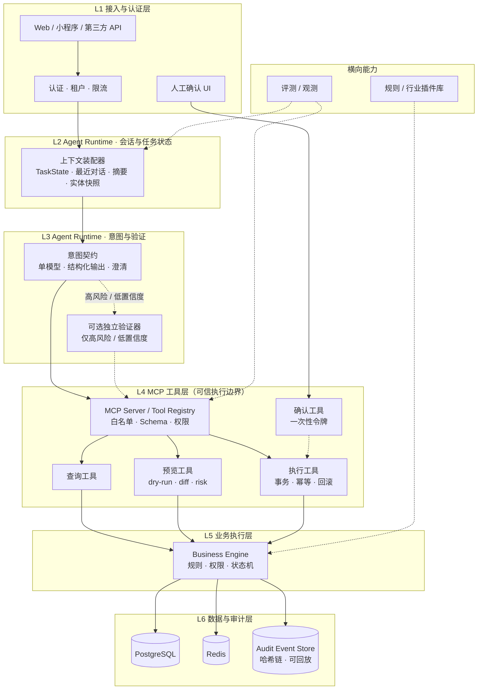
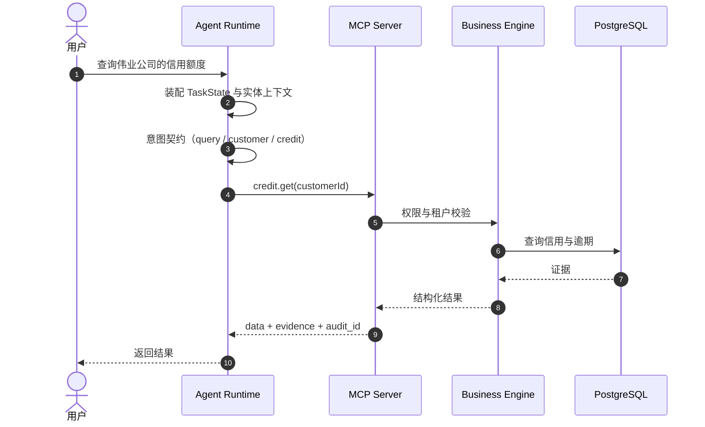
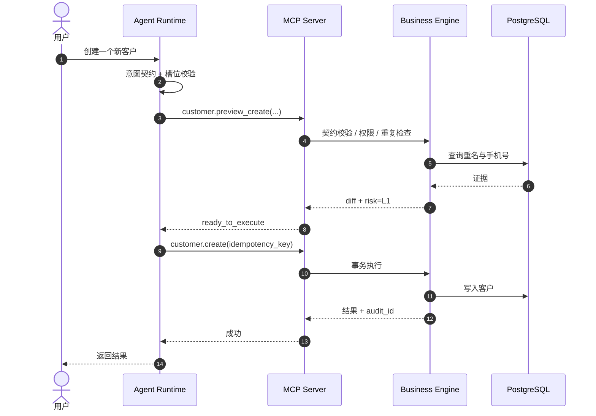
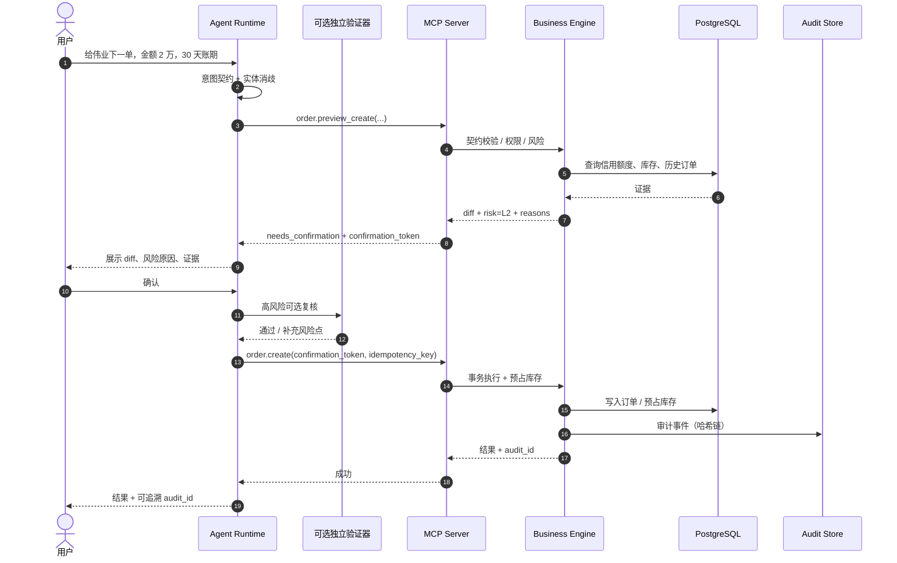
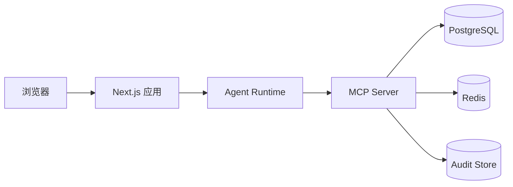
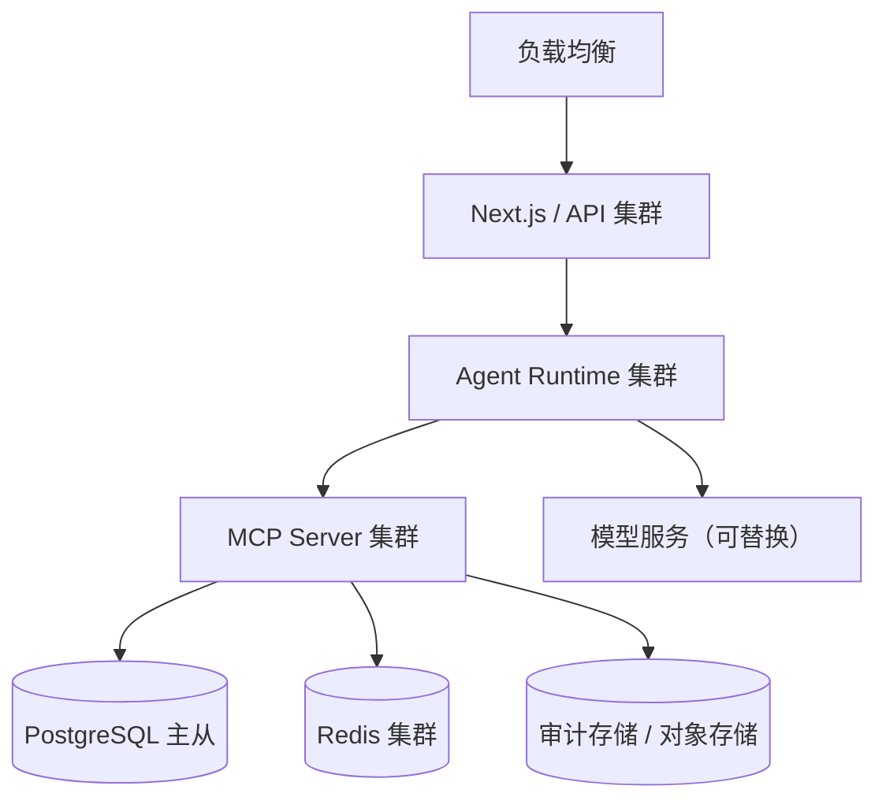

# 整体技术架构设计

> 本文档描述当前技术架构：以 MCP 工具链为可信执行边界，Agent Runtime 可替换，所有业务写入经过契约校验、预览、确认、幂等执行与审计。
>
> 本文档是 **LyMatrix TEF** 的系统全貌文档；CRM-ERP 为参考实现，不是框架本体。

---

## 1. 架构定位与设计原则

### 1.1 核心主张

> Agent 是可替换的大脑，MCP 工具链是不可绕过的脊柱。

模型负责理解与提议，确定性系统负责校验与执行，风险分级决定是否人工授权，审计负责追责。模型可以更换，但任何模型都不能绕过 MCP 工具层的约束。

### 1.2 六条设计原则

| # | 原则 | 说明 |
|---|------|------|
| 1 | 模型只提议，不执行 | LLM 只输出结构化意图与参数，不直接访问数据库，不直接决定写入 |
| 2 | 工具即边界 | 所有业务写入必须经过 MCP Server；Agent 不持有数据库凭据 |
| 3 | 契约优先 | 每类业务操作都有 Schema、前置条件、不变量、权限、风险规则和补偿动作 |
| 4 | 预览后执行 | 写操作先 preview（dry-run + diff + 风险），再 confirm，最后 execute |
| 5 | 人在回路 | 高风险写入必须由人查看 diff 与证据后授权 |
| 6 | 可审计、可回放、可评测 | 每次决策和写入都有事件记录；核心能力有评测指标 |

### 1.3 与旧架构的区别

| 维度 | 旧架构 | 当前架构 |
|------|--------|----------|
| Agent 内核 | OpenClaw 内核定制 | 轻量 Agent Runtime + MCP Client；无 OpenClaw 依赖 |
| 决策方式 | 主 Agent + 两个子 Agent 分层投票 | 单模型提议 + 确定性校验 + 风险路由；高风险时可选独立验证器 |
| 防护方式 | 六重防护、Hook 串联 | 可信执行边界：契约、权限、dry-run、确认、幂等、回滚、审计 |
| 工具形态 | 通用 MCP 工具白名单 | 特制业务操作工具：查询 / 预览 / 执行 / 治理 |
| 数据访问 | Agent 调用 BusinessEngine | Agent 只能调用 MCP 工具；BusinessEngine 位于 MCP Server 内部 |
| 上下文 | 依赖会话历史 | 对话上下文与业务 TaskState 分离；事件溯源 |

---

## 2. 总体架构图

### 2.1 分层架构



### 2.2 请求路径速览

```
用户/前端
  → 认证与租户
  → Agent Runtime（上下文装配 + 意图契约 + 可选验证器）
  → MCP Server（查询 / 预览 / 确认 / 执行）
  → Business Engine（规则 / 权限 / 状态机）
  → PostgreSQL / Redis / Audit Store
```

---

## 3. 分层职责矩阵

| 层级 | 名称 | 核心职责 | 绝对不能做什么 |
|------|------|----------|----------------|
| L1 | 接入与认证层 | 认证、租户识别、限流、请求规范化 | 处理业务规则 |
| L2 | Agent Runtime 会话与任务状态层 | 装配 TaskState、对话摘要、实体快照；恢复未完成任务 | 把聊天记录当作业务事实 |
| L3 | Agent Runtime 意图与验证层 | 意图识别、槽位抽取、置信度评估、澄清；高风险时调用独立验证器 | 直接写库，或直接决定金额/库存/权限 |
| L4 | MCP 工具层 | 工具白名单、Schema 校验、权限、预览、确认令牌、幂等、审计 | 暴露裸 SQL / 裸 CRUD；绕过权限 |
| L5 | 业务执行层 | 规则引擎、权限、状态机、事务、补偿 | 接受未经契约校验的参数 |
| L6 | 数据与审计层 | 业务数据、缓存、事件日志、哈希链 | 被 Agent 直接访问 |

横向能力：安全与租户隔离、评测与观测、规则/行业插件库。

---

## 4. 核心请求流程

### 4.1 L0 查询



L0 不写库，不需要确认。

### 4.2 L1 普通写入



L1 可自动执行，但必须经过 preview 和幂等执行。

### 4.3 L2 高风险写入



L2 必须人工确认；确认令牌一次性、绑定用户/会话/操作哈希、带过期时间。确认后由服务端重新取原始契约执行，不允许模型重新生成业务参数。

---

## 5. MCP 工具链设计

### 5.1 工具分类

| 类别 | 说明 | 是否写库 | 示例 |
|------|------|----------|------|
| 查询工具 | 只读事实查询，返回证据 | 否 | `customer.search`、`credit.get`、`inventory.check` |
| 预览工具 | 校验并返回 diff、风险、确认令牌 | 否 | `order.preview_create`、`payment.preview_record` |
| 执行工具 | 凭确认令牌执行写入，要求幂等键 | 是 | `order.create`、`payment.record` |
| 治理工具 | 人工确认、白名单、审计查询 | 部分 | `confirmation.approve`、`audit.trace` |
| 知识工具 | 返回业务规则、政策、字段说明 | 否 | `policy.get`、`schema.get` |

### 5.2 工具命名与注解

- 命名格式：`<领域>.<动作>`，例如 `order.preview_create`、`credit.get`。
- 使用 MCP 工具注解区分风险：`readOnlyHint`、`destructiveHint`、`idempotentHint`、`openWorldHint`。
- 每个工具的 `inputSchema` 必须严格定义类型、枚举、范围和必填字段；禁止 `additionalProperties: true`。
- 工具描述必须说明：是否写库、是否需要确认、幂等语义、失败语义。

### 5.3 核心工具清单（MVP）

| 工具 | 类型 | 说明 |
|------|------|------|
| `customer.search` | 查询 | 按名称/电话查客户，返回候选与匹配置信度 |
| `credit.get` | 查询 | 返回信用额度、已用额度、逾期天数 |
| `inventory.check` | 查询 | 返回 SKU 可用库存与预占库存 |
| `order.preview_create` | 预览 | 校验订单契约，返回 diff、风险、确认令牌 |
| `order.create` | 执行 | 凭确认令牌和幂等键创建订单、预占库存 |
| `confirmation.approve` | 治理 | 人工确认，绑定用户、会话、操作哈希；仅对人工 UI/后台暴露，不注册到 Agent Runtime |
| `audit.trace` | 查询 | 按 trace_id 返回完整决策链 |
| `policy.get` | 知识 | 返回当前租户的风险阈值与业务规则 |

`confirmation.approve` 不暴露给模型。模型只能看到 `needs_confirmation` 状态和确认令牌，不能自行确认；确认动作必须由已登录用户通过人工 UI 或后台发起。

### 5.4 统一返回结构

```json
{
  "status": "ok | needs_confirmation | blocked | error",
  "data": {},
  "diff": {},
  "evidence": {},
  "risk": "L0 | L1 | L2",
  "reasons": [],
  "confirmation_token": "ct_...",
  "expires_at": "2026-11-03T12:00:00Z",
  "audit_id": "aud_...",
  "error": {
    "code": "VALIDATION_ERROR",
    "message": "total_amount does not match items"
  }
}
```

### 5.5 错误分类

| 错误码 | 含义 | Agent 应如何处理 |
|--------|------|------------------|
| `VALIDATION_ERROR` | 参数或业务约束不合法 | 向用户解释并请求修正 |
| `PERMISSION_DENIED` | 权限不足 | 告知用户，不重试 |
| `NOT_FOUND` | 实体不存在 | 请求澄清或重新搜索 |
| `CONFLICT` | 并发冲突或重复操作 | 重新读取状态后再决定 |
| `NEEDS_CONFIRMATION` | 需要人工确认 | 展示 diff 并等待确认 |
| `RATE_LIMITED` | 频率超限 | 退避后重试 |
| `INTERNAL` | 服务端错误 | 不重试写操作，返回审计 ID |

---

## 6. 上下文与任务状态

### 6.1 对话上下文与业务状态分离

| 类型 | 内容 | 存储 |
|------|------|------|
| 对话上下文 | 最近消息、摘要、用户偏好 | Redis / Message 表 |
| 业务状态 | 当前任务、槽位、待确认操作、实体快照、幂等键 | PostgreSQL / TaskState 表 |

用户说“把刚才那单改了”时，系统依赖的是 `activeOrderId`、`pendingOperation`、`confirmationId`，而不是把整段聊天重新交给模型。

### 6.2 上下文装配顺序

1. 固定系统策略与安全规则
2. 当前 TaskState
3. 权威实体快照（从数据库查询）
4. 工具定义（固定、可缓存）
5. 最近 N 轮对话
6. 滚动摘要
7. 检索到的文档/记忆（带出处）
8. 当前用户输入

稳定内容放前面，易变内容放后面，便于提示词缓存。

### 6.3 任务状态机

```
idle
  → intent_parsed
  → context_loaded
  → preview_ready
  → awaiting_confirmation
  → executing
  → completed | failed | rolled_back
```

每个状态转换都写入事件日志；服务崩溃后可从 TaskState 和事件日志恢复。

### 6.4 事件溯源与审计

- 每次用户输入、模型提议、工具调用、校验结果、确认、执行、回滚都记录为事件。
- 事件包含：`trace_id`、`tenant_id`、`user_id`、`tool`、`args_hash`、`result`、`model_version`、`prompt_version`、`timestamp`。
- 审计日志使用哈希链，任何篡改可被发现。
- 支持按订单、客户、用户、trace_id 回放完整决策链。

---

## 7. 防幻觉与风险控制

### 7.1 分层控制

| 层 | 机制 | 作用 |
|----|------|------|
| 事实层 | 工具 grounding | 客户、订单、库存、额度必须查库，不能由模型编造 |
| 输出层 | 结构化输出 | JSON Schema / zod 约束意图与参数形状 |
| 规则层 | 确定性校验 | 前置条件、不变量、权限、金额边界、状态机 |
| 预览层 | dry-run + diff | 展示“将要发生什么”，拦截不一致 |
| 确认层 | 人工确认 | 高风险操作由人看 diff 后授权 |
| 执行层 | 事务 + 幂等 + 回滚 | 重复点击不重复执行，失败可补偿 |
| 审计层 | 事件日志 + 哈希链 | 可追溯、可回放、可追责 |
| 评估层 | 评测集 + 指标 | 证明机制有效，而不是停留在概念 |

### 7.2 风险路由

| 等级 | 操作类型 | 路径 | 人工确认 |
|------|----------|------|----------|
| L0 | 查询 | 查询工具直读 | 不需要 |
| L1 | 低风险写入 | preview → execute | 不需要，但需幂等与审计 |
| L2 | 高风险写入 | preview → 可选验证器 → 人工确认 → execute | 必须 |
| Block | 非法/越权/违反不变量 | 直接阻断 | 不进入确认 |

### 7.3 多 Agent 的定位

多 Agent 不再是默认风控层。只在以下场景使用：

- 高风险或低置信度时的独立验证器
- 不同工具/数据源的专业代理
- 对抗式红队检查（提示注入、权限绕过）
- 不同厂商模型的第二意见

同模型、同上下文、不同提示词的“投票”不作为核心机制。

---

## 8. 技术选型

| 类别 | 技术 | 说明 |
|------|------|------|
| 前端 | Next.js 16 / React 19 | 当前代码已采用 |
| 语言 | TypeScript | 前后端统一 |
| Agent Runtime | 自研轻量循环 + MCP Client | 模型无关，可替换 |
| 工具协议 | MCP（`@modelcontextprotocol/sdk`） | 工具发现、调用、Schema |
| 业务引擎 | TypeScript + Prisma 7 | 规则、权限、事务、补偿 |
| 数据库 | PostgreSQL | 业务数据与审计事件 |
| 缓存 | Redis | 会话、限流、热点状态 |
| 认证 | Cookie Session + bcrypt；生产可升级 OAuth/JWT | 当前为 MVP |
| 评测 | Vitest + 自研评测 harness | 意图、拦截率、延迟、成本 |
| 部署 | Docker Compose（MVP）；K8s（后续） | 先跑通再扩展 |
| 模型 | MiniMax 或任意支持工具调用的模型 | 模型可替换，工具链不变 |

---

## 9. 安全设计

| 风险 | 措施 |
|------|------|
| 未认证访问 | 除登录外所有 API 默认要求会话；服务端解析用户与租户 |
| 越权 | 工具级 scope + 行级租户隔离；不信任模型传入的 userId/tenantId |
| 提示注入 | 工具结果与检索内容视为数据；指令与数据通道分离；写操作人工确认 |
| 工具投毒 | 只加载白名单 MCP Server；远程 Server 需审核/签名；不自动安装未知工具 |
| 混淆代理 | MCP Server 自己认证用户和租户，不信任 Agent 的声明 |
| Token 透传 | 不把用户令牌透传给第三方工具；使用短期、最小权限令牌 |
| 破坏性操作 | `destructiveHint` + 强制确认 + 频率限制 |
| SSRF/路径穿越 | 工具参数中的 URL/路径白名单与规范化 |
| 重复执行 | 幂等键 + 唯一约束 + 事务 |
| 审计缺失 | 每次工具调用记录 trace_id、args_hash、caller、tenant、结果 |

---

## 10. 部署架构

### 10.1 MVP



MVP 可以用 Docker Compose 启动 PostgreSQL、Redis、MCP Server 和 Next.js 应用，MCP Server 先使用 stdio 或本地 HTTP transport。

### 10.2 生产



生产环境将 MCP Server 独立部署，Agent Runtime 保持无状态，任务状态和审计落库；模型服务通过适配器接入，可随时替换。

---

## 11. 关键设计决策

### 11.1 为什么不再使用 OpenClaw

| 考量 | 分析 |
|------|------|
| 实际依赖 | 当前代码没有 OpenClaw 依赖，文档中的“内核定制”没有落地 |
| 价值 | OpenClaw 是 MIT 开源，本身不构成壁垒；MCP 已能覆盖工具注册与调用 |
| 复杂度 | 多一层框架抽象，增加版本锁定和调试成本 |
| 可替换性 | 轻量 Agent Runtime + MCP Client 更容易替换模型和部署形态 |

### 11.2 为什么选择 MCP

| 考量 | 分析 |
|------|------|
| 标准化 | 工具发现、Schema、调用协议统一 |
| 模型无关 | MiniMax、Claude 或其他模型都可以作为大脑 |
| 信任边界 | MCP Server 是唯一写入通道，权限和审计集中 |
| 可测试 | 工具可以脱离模型单独测试 |

### 11.3 为什么是“单模型 + 确定性校验”，而不是“多 Agent 投票”

| 问题 | 多 Agent 投票 | 单模型 + 确定性校验 |
|------|---------------|---------------------|
| 相关性 | 同模型投票容易一起错 | 规则/数据库是独立证据 |
| 成本 | 每笔操作多次调用 | 只在必要时调用一次 |
| 延迟 | 2-3 倍 | 可控 |
| 可解释 | 投票理由难归因 | 每条规则可解释 |
| 可测试 | 难 | 规则和工具可单测 |

多 Agent 保留为高风险时的可选独立验证器，而不是默认层。

### 11.4 为什么 preview / execute 分离

- 人类看到的是 diff，不是模型自述。
- 确认令牌绑定原始操作哈希，模型无法在确认后偷改参数。
- 执行前可以再次做权限与状态校验。
- 幂等键保证重复点击不会重复写入。

---

## 12. 演进路线

| 阶段 | 目标 | 交付物 |
|------|------|--------|
| Phase 0 | 跑通“赊账订单”闭环 + 多租户底座 | `customer.search`、`credit.get`、`inventory.check`、`order.preview_create`、`order.execute_create`、Tenant/RLS |
| Phase 1 | 可信执行边界 | 契约 Schema、dry-run/diff、确认令牌、幂等、冲突恢复、补偿、审计事件 |
| Phase 2 | 可测量 | 300-500 条评测集、危险写入拦截率、误拒率、P95、成本；可选独立验证器 |
| Phase 3 | 行业化 | 义乌规则插件、计量计费与配额、角色细化、生产部署、软著/专利/论文材料 |

---

## 相关文档

- [../00-positioning.md](../00-positioning.md) — 定位与命名（项目身份、边界与成熟度）
- [14-unified-architecture.md](14-unified-architecture.md) — 统一架构框架（裁决版，权威；与本文冲突时以 14 号为准）
- [01-multi-agent-design.md](01-multi-agent-design.md) — Multi-Agent 协同决策系统设计（历史方案，投票已降级为可选验证器）
- [02-openclaw-development.md](02-openclaw-development.md) — OpenClaw 内核定制方案（历史方案，当前不再使用）
- [03-mcp-tool-whitelist.md](03-mcp-tool-whitelist.md) — MCP 工具白名单体系
- [04-business-engine.md](04-business-engine.md) — 统一业务引擎设计
- [05-four-layer-safety.md](05-four-layer-safety.md) — 六重防护机制详解（历史方案，当前以可信执行边界为准）
- [07-data-flow-design.md](07-data-flow-design.md) — 核心请求全流程设计
- [08-risk-classification.md](08-risk-classification.md) — 风险分级体系
- [09-fast-path.md](09-fast-path.md) — 快速通道与白名单机制
- [10-dynamic-risk.md](10-dynamic-risk.md) — 动态风险评估
- [11-fallback.md](11-fallback.md) — 多级兜底策略
- [12-hook-system-design.md](12-hook-system-design.md) — Hook 系统详细设计（作为可选增强保留）
- [13-trusted-execution-architecture.md](13-trusted-execution-architecture.md) — 可信执行架构详细设计（业务操作契约、MCP 工具链、评测基准）
